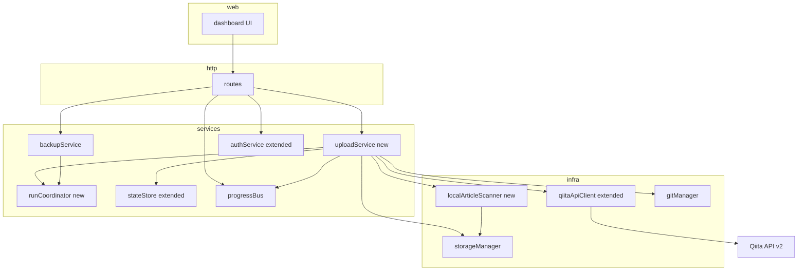
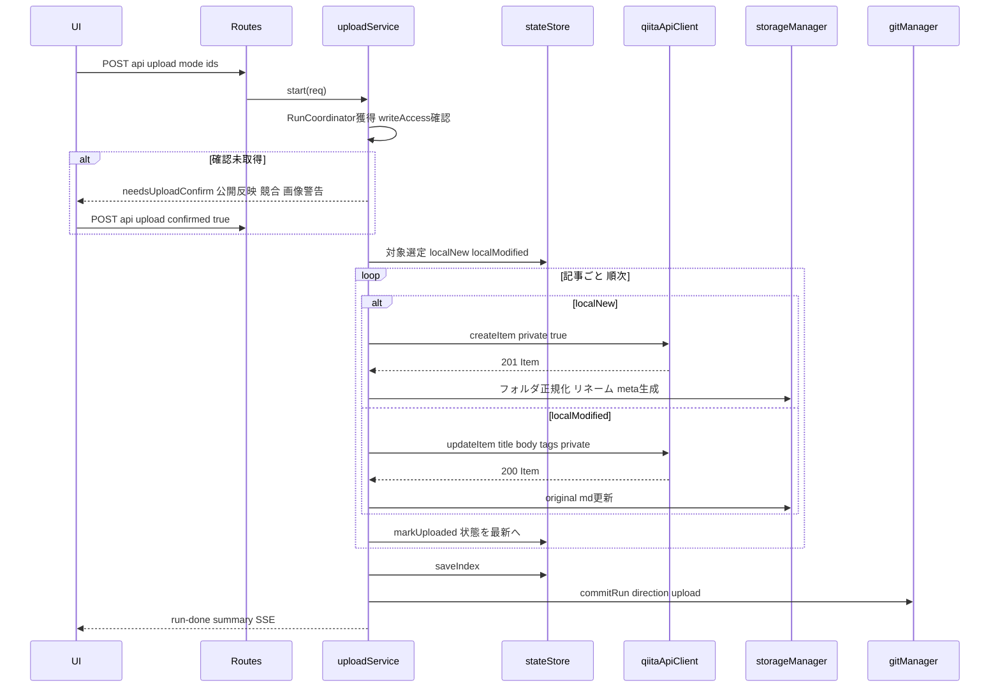
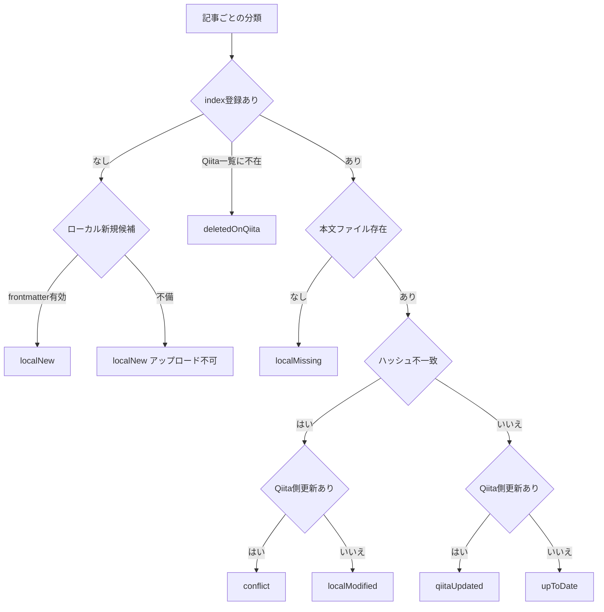

# Technical Design — article-upload-sync

## Overview

**Purpose**: 本機能は、Qiita記事バックアップツールにローカル→Qiitaのアップロード方向の同期を追加し、`backups/` で執筆・編集した記事をQiitaへ反映する手段を記事の作者へ提供する。

**Users**: 既存ツールの利用者(Qiita記事の作者)が、ローカルで新規作成した記事の限定共有(非公開)登録、およびローカルで編集した既存記事の本文更新に利用する。

**Impact**: 既存の「単方向(Qiita→ローカル)・読み取り専用」アーキテクチャに、明示的なユーザ操作に限定した書き込み経路を追加する。既存のダウンロード機能・データ構成・`read_qiita` のみでの利用は変更しない。状態モデルは5状態から8状態へ拡張する。

### Goals
- ローカル新規記事の検出と、限定共有(非公開)としてのQiita登録
- ローカル改変記事の本文更新(選択/変更点全件の2モード)
- 更新日時・ハッシュ突合による差分管理と競合保護
- 既存Run基盤(進捗SSE・中断・429待機・リトライ・Gitコミット)への統合

### Non-Goals
- 画像のQiitaへのアップロード(API v2に手段が存在しない — research.md)
- 記事の削除同期・削除済み記事の再登録(復元)
- 記事の公開操作(公開はQiita上でユーザが行う)・既存記事の公開範囲変更
- 既存記事のタイトル・タグのローカル編集の同期
- 自動・定期同期、Qiita Team対応

## Boundary Commitments

### This Spec Owns
- アップロードRunの統括(対象選定・確認フロー・実行・結果記録)
- ローカル新規記事の検出規約(frontmatter付きMarkdown)と正規化(既存レイアウトへの変換)
- 状態モデルの拡張(`localNew` / `conflict` / `localMissing` の追加)と分類規則
- `QiitaApiClient` の書き込み契約(`createItem` / `updateItem`)
- Run排他の共有機構(`RunCoordinator`)の契約

### Out of Boundary
- ダウンロード(バックアップ)Runの内部ロジック(排他の獲得方法のみ変更)
- `index.json` の既存フィールドの意味・Git世代管理の仕組み(そのまま利用)
- トークンの保存・マスク表示の仕組み(既存 `tokenStore` / `envConfig` を利用)
- ステアリング改訂の内容自体(qiita-api.md / security.md への追記は実装タスクとして扱う)

### Allowed Dependencies
- 上流: `qiitaApiClient`(書き込みは本クライアントのみ — Authorization付与の一元化を維持)、`storageManager`、`stateStore`、`progressBus`、`gitManager`、`tokenStore`
- 依存方向は steering structure.md のとおり `http → services → infra → config/types` を厳守。`uploadService` は infra のインターフェースのみに依存する

### Revalidation Triggers
- `BackupStatus` ユニオンの追加・変更(UI・API・集計・テストへ波及)
- `index.json` / `meta.json` スキーマの変更
- `ProgressEvent` の形状変更(SSEクライアントへ波及)
- Qiita API書き込み仕様の変更(PATCH必須項目・privateの挙動)

## Architecture

### Existing Architecture Analysis
- レイヤード構成・`Result<T,E>`・`Deps` DI・`XxxImpl`/`createXxx` の規約を全面踏襲する
- Run排他は現在 `BackupServiceImpl` 内部の `running` フラグ — 相互排他のため `RunCoordinator` へ抽出する(唯一の既存リファクタリング)
- `Authorization` ヘッダ付与は `QiitaApiClient` に一元化されており、書き込みメソッドも同クラスへ追加する(steering security.md 準拠)

### Architecture Pattern & Boundary Map



**Architecture Integration**:
- 採用パターン: ハイブリッド(gap-analysis Option C)。アップロードRun統括は新規 `uploadService`、書き込みAPI・状態分類・走査は既存モジュールの拡張
- 境界: `uploadService` がアップロードの唯一のオーケストレータ。書き込みHTTPは `qiitaApiClient` のみ、ローカルファイル走査は `localArticleScanner` のみが担う(隠れた共有所有なし)
- 保持する既存パターン: Run単位のライフサイクル(start→progress→done)、SSE進捗、記事単位リトライ、終了時 index保存+Gitコミット
- steering準拠: 依存方向・認証集約・最小依存(新規外部ライブラリなし)

### Technology Stack

| Layer | Choice / Version | Role in Feature | Notes |
|-------|------------------|-----------------|-------|
| Backend / Services | TypeScript 5(strict)+ Node.js 24 ESM | uploadService / runCoordinator / scanner | 新規依存なし。frontmatterは平坦形式限定の自作パーサ(research.md) |
| External API | Qiita API v2 `POST /items`, `PATCH /items/:item_id` | 記事の新規登録・本文更新 | PATCH は `title`+`body` 必須。`private` は常に明示送信 |
| Frontend | 素のTypeScript(esbuild) | アップロード操作・確認ダイアログ・状態表示 | 既存 `src/web/main.ts` の拡張 |
| Data / Storage | `index.json` / `meta.json`(既存スキーマ+追加光学フィールド) | 状態・履歴の永続化 | 破壊的変更なし(`RunSummary.direction` を追加、省略時 `backup`) |
| Messaging / Events | SSE(既存 progressBus) | アップロード進捗配信 | `run-start` に `direction` を追加 |

## File Structure Plan

### Directory Structure
```
src/
├── services/
│   ├── uploadService.ts       # 新規: アップロードRun統括(対象選定・確認・実行・記録)
│   └── runCoordinator.ts      # 新規: Run排他の共有機構(backup/upload相互排他)
├── infra/
│   └── localArticleScanner.ts # 新規: backups/走査・frontmatter解析・新規記事候補の列挙
└── web/                       # 既存3ファイルの拡張(UI追加)
tests/
├── uploadService.test.ts      # 新規
├── localArticleScanner.test.ts# 新規
└── runCoordinator.test.ts     # 新規
```

### Modified Files
- `src/types/index.ts` — `BackupStatus` 3状態追加、`UploadRunMode`・`UploadStartError`・`LocalDraft`・書き込み入力型、`ConnectionStatus.writeAccess`、`RunSummary.direction`、`ProgressEvent` 拡張
- `src/infra/qiitaApiClient.ts` — `createItem`/`updateItem` 追加、`request()` のメソッド/ボディ対応
- `src/services/stateStore.ts` — 8状態分類(`classify` にローカル新規を合流)、`markUploaded`、`summarize` 拡張
- `src/services/backupService.ts` — 排他を `RunCoordinator` へ委譲、対象選定の新状態対応(conflict/localMissing)
- `src/services/authService.ts` — `writeAccess` 実績ベース管理
- `src/services/progressBus.ts` — イベント型拡張(`direction`)
- `src/http/routes.ts` — `/api/upload`・`/api/upload/cancel` 追加、`/api/articles` の応答拡張
- `src/web/index.html` / `main.ts` / `styles.css` — アップロードUI・確認ダイアログ・状態表示
- `scripts/mock-qiita.mjs`・`tests/helpers/mockQiitaServer.ts` — POST/PATCH エンドポイント追加
- `.kiro/steering/qiita-api.md`・`security.md` — 書き込み経路・スコープ方針の追記改訂
- `README.md` / `README.ja-JP.md` — 新規記事の作成規約の案内(1.4)

## System Flows

### アップロードRunのシーケンス



- 最初の書き込みが403の場合は残り全件を中止し `run-error`(スコープ不足の案内)を発行、`writeAccess=denied` を記録する(6.2, 6.3, 9.3)
- 429は `Rate-Reset` まで待機して同一記事から再開(9.1)。network/5xxは記事単位で上限付きリトライし、超過時は失敗記録して継続(9.2)
- 中断指示は処理中記事の完了を待って停止(7.2)。いずれの終了でも index保存+Gitコミットを行う(7.5)

### 状態分類フロー(拡張後)



- 「Qiita側更新あり」= `item.updatedAt > entry.qiitaUpdatedAt`(既存判定)。「ハッシュ不一致」= 閲覧用Markdownのsha256が `entry.contentHash` と異なる(既存判定)— 2.1の「既存検知方式の踏襲」に対応
- 未バックアップ(`notBackedUp`)はQiita一覧に存在しindex未登録の場合(既存どおり、図では省略)

## Requirements Traceability

| Requirement | Summary | Components | Interfaces | Flows |
|-------------|---------|------------|------------|-------|
| 1.1 | 未対応フォルダの走査検出 | localArticleScanner | `scan()` | 状態分類 |
| 1.2 | 規約充足→localNew表示 | localArticleScanner, stateStore, UI | `LocalDraft`, `classify()` | 状態分類 |
| 1.3 | メタ不備→不可+理由表示 | localArticleScanner, UI | `LocalDraft.invalidReasons` | 状態分類 |
| 1.4 | 作成規約の案内 | UI, README | — | — |
| 2.1 | 既存方式踏襲の状態判定 | stateStore | `classify()` | 状態分類 |
| 2.2 | ローカル改変=本文存在+変更 | stateStore | `classify()` | 状態分類 |
| 2.3 | 欠落→復元案内 | stateStore, UI | `localMissing` | 状態分類 |
| 2.4 | Qiita側更新の表示 | stateStore | 既存 `qiitaUpdated` | 状態分類 |
| 2.5 | 競合の除外(全件UP・差分DL) | stateStore, uploadService, backupService | `selectTargets` 系 | 両Run |
| 2.6 | 競合の選択DLは上書き確認 | backupService | `needsOverwriteConfirm` | — |
| 2.7 | 既存5状態と両立 | stateStore, UI | `BackupStatus` | 状態分類 |
| 3.1 | 選択アップロード | uploadService, routes, UI | `POST /api/upload` | シーケンス |
| 3.2 | 新規→新規登録 | uploadService, qiitaApiClient | `createItem` | シーケンス |
| 3.3 | 改変→本文更新(タイトル・タグ同期外) | uploadService, qiitaApiClient | `updateItem` | シーケンス |
| 3.4 | 公開記事更新の事前確認 | uploadService, UI | `needsUploadConfirm` | シーケンス |
| 3.5 | 競合の選択UPは警告+承認 | uploadService, UI | `needsUploadConfirm.conflicts` | シーケンス |
| 3.6 | 削除済み・欠落の選択UP拒否 | uploadService | `UploadStartError.invalidTargets` | — |
| 4.1 | 全件=localNew+localModified | uploadService | `selectUploadTargets` | シーケンス |
| 4.2 | 対象外状態の除外 | uploadService | 同上 | シーケンス |
| 4.3 | 実行前の対象提示+確認 | uploadService, UI | `needsUploadConfirm.targets` | シーケンス |
| 5.1 | 非公開(private true)登録 | qiitaApiClient | `createItem` | シーケンス |
| 5.2 | 非公開である旨のUI明示 | UI | 確認ダイアログ文言 | — |
| 5.3 | 公開範囲を変更しない | uploadService, qiitaApiClient | `updateItem`(private明示送信) | シーケンス |
| 6.1 | read_qiitaのみで既存機能維持 | authService | `writeAccess` 独立管理 | — |
| 6.2 | 書き込みスコープの事前検証 | uploadService, authService | `writeAccess` 事前拒否+初回403判定 | シーケンス |
| 6.3 | 不足時は実行せず案内 | uploadService, UI | `run-error` scope案内 | シーケンス |
| 6.4 | 権限種別の表示 | authService, UI | `ConnectionStatus.writeAccess` | — |
| 7.1 | 進捗表示 | progressBus, UI | `ProgressEvent` | シーケンス |
| 7.2 | 中断は処理中完了待ち | uploadService | `cancel()` | シーケンス |
| 7.3 | 新規のID対応付け→最新 | uploadService, storageManager, stateStore | `normalizeDraft`, `markUploaded` | シーケンス |
| 7.4 | 更新後のupdatedAt記録→最新 | uploadService, stateStore | `markUploaded` | シーケンス |
| 7.5 | 終了時index保存+Gitコミット | uploadService, gitManager | `commitRun` | シーケンス |
| 7.6 | 結果サマリ+履歴 | uploadService, stateStore, UI | `RunSummary(direction)` | シーケンス |
| 8.1 | 明示操作のみ書き込み | routes, uploadService | POSTエンドポイント限定 | — |
| 8.2 | 削除しない | qiitaApiClient | DELETE非実装 | — |
| 8.3 | ローカル画像参照の警告 | uploadService | `needsUploadConfirm.imageWarnings` | シーケンス |
| 8.4 | 同時実行1件 | runCoordinator | `acquire()` | シーケンス |
| 9.1 | 429待機継続 | uploadService, qiitaApiClient | `rateLimited` 待機 | シーケンス |
| 9.2 | 記事単位リトライ | uploadService | retryLimit | シーケンス |
| 9.3 | 401/403中断+案内 | uploadService, UI | `run-error` | シーケンス |
| 9.4 | 失敗一覧の記録 | uploadService, logger | `RunSummary.failures` | — |

## Components and Interfaces

| Component | Domain/Layer | Intent | Req Coverage | Key Dependencies (P0/P1) | Contracts |
|-----------|--------------|--------|--------------|--------------------------|-----------|
| RunCoordinator | services | backup/upload Runの相互排他 | 8.4 | — | Service |
| LocalArticleScanner | infra | 新規記事候補の走査・frontmatter解析 | 1.1–1.3 | StorageManager (P0) | Service |
| UploadService | services | アップロードRun統括 | 3, 4, 5, 6.2–6.3, 7, 8.1/8.3, 9 | QiitaApiClient (P0), StateStore (P0), RunCoordinator (P0), StorageManager (P0), ProgressBus (P1), GitManager (P1) | Service / Event |
| QiitaApiClient(拡張) | infra | 書き込みエンドポイントの追加 | 3.2, 3.3, 5.1, 5.3, 8.2, 9.1 | TokenStore (P0) | Service |
| StateStore(拡張) | services | 8状態分類・アップロード結果反映 | 1.2, 2.1–2.7, 7.3–7.4 | StorageManager (P0), LocalArticleScanner (P1) | Service / State |
| AuthService(拡張) | services | writeAccess実績管理 | 6.1, 6.2, 6.4 | QiitaApiClient (P0) | Service |
| Routes / UI(拡張) | http / web | アップロードAPI・確認ダイアログ・状態表示 | 1.4, 3.1, 4.3, 5.2, 6.4, 7.1, 7.6, 8.1 | UploadService (P0) | API |

### services

#### RunCoordinator

| Field | Detail |
|-------|--------|
| Intent | バックアップ/アップロードを通じたRun同時実行1件の保証 |
| Requirements | 8.4 |

**Responsibilities & Constraints**
- Runリース(獲得・解放)のみを所有。Runの中身は関知しない
- 単一プロセス内のインメモリ排他(サーバは1プロセスのため分散考慮は不要)

**Dependencies**
- Inbound: BackupService / UploadService — Run開始時の獲得(P0)

**Contracts**: Service [x]

##### Service Interface
```typescript
export type RunKind = "backup" | "upload";
export type RunLease = { kind: RunKind; runId: string; release(): void };

export interface RunCoordinator {
  /** 実行中Runがあれば conflict(実行中の kind を含む) */
  acquire(kind: RunKind, runId: string): Result<RunLease, { kind: "conflict"; active: RunKind }>;
  /** 現在実行中のRun種別(なければ null) */
  active(): RunKind | null;
}
```
- Preconditions: なし
- Postconditions: `acquire` 成功後、`release()` が呼ばれるまで他の `acquire` は失敗する
- Invariants: 同時にアクティブなリースは常に1つ以下

**Implementation Notes**
- Integration: `BackupServiceImpl` の `running` フラグを本機構への委譲に置換(挙動不変、既存テストで回帰確認)
- Risks: `release()` 漏れによるデッドロック — Run終了の `finally` で解放する規約をテストで固定

#### UploadService

| Field | Detail |
|-------|--------|
| Intent | アップロードRunの統括(対象選定・確認フロー・書き込み・結果反映・記録) |
| Requirements | 3.1–3.6, 4.1–4.3, 5.1, 5.3, 6.2, 6.3, 7.1–7.6, 8.1, 8.3, 9.1–9.4 |

**Responsibilities & Constraints**
- アップロード方向の業務ルールを一元所有(対象選定、確認要求の判定、逆書換、ID対応付け)
- 書き込みは1記事ずつ直列(レート配慮)。Run終了時に必ず index保存+Gitコミット
- ダウンロード方向のロジックには一切関与しない

**Dependencies**
- Inbound: Routes — Run開始・中断(P0)
- Outbound: QiitaApiClient(P0)/ StateStore(P0)/ StorageManager(P0)/ RunCoordinator(P0)/ LocalArticleScanner(P0)/ ProgressBus(P1)/ GitManager(P1)/ AuthService(P1: writeAccess参照・更新)

**Contracts**: Service [x] / Event [x]

##### Service Interface
```typescript
export type UploadMode = "changes" | "selected";

export type UploadStartRequest = {
  mode: UploadMode;
  /** selected時: Qiita記事ID または ローカル新規キー(local:{folderName}) */
  ids?: string[];
  /** 実行前確認(4.3, 3.4, 3.5, 8.3)への同意フラグ */
  confirmed?: boolean;
};

export type UploadConfirmInfo = {
  targets: { key: string; title: string; kind: "create" | "update" }[];
  publicUpdates: { id: string; title: string }[];   // 3.4 即時公開反映の対象
  conflicts: { id: string; title: string }[];       // 3.5 競合(選択時のみ許容)
  imageWarnings: { key: string; title: string; refs: string[] }[]; // 8.3
};

export type UploadStartError =
  | { kind: "conflict"; active: RunKind }                    // 8.4
  | { kind: "writeAccessDenied" }                            // 6.2 既知の権限不足
  | { kind: "needsUploadConfirm"; info: UploadConfirmInfo }  // 3.4, 3.5, 4.3, 8.3
  | { kind: "invalidTargets"; details: { key: string; reason: string }[] } // 3.6, 1.3
  | { kind: "invalidRequest"; message: string };

export interface UploadService {
  start(req: UploadStartRequest): Result<RunHandle, UploadStartError>;
  cancel(): void; // 7.2
}
```
- Preconditions: `selected` は `ids` 必須。競合記事は `selected`+`confirmed` のときのみ対象化(3.5)。`changes` は競合・欠落・削除済みを常に除外(4.1, 4.2)
- Postconditions: 成功記事は状態「最新」へ遷移(7.3, 7.4)。403(スコープ不足)発生時は以降の書き込みを行わずRunを終了し `writeAccess=denied` を記録(6.3)
- Invariants: `confirmed` なしで書き込みが1件も発生しない(3.4, 4.3, 8.1)

##### Event Contract
- Published(既存 ProgressBus 経由): `run-start`(`direction: "upload"` 追加)/ `progress` / `article-done` / `waiting-rate-limit` / `run-error` / `run-done`
- 順序保証: 単一Run内で直列発行(既存と同じ)

**Implementation Notes**
- Integration: 逆書換は `rewriteImageRefs`(backupService)と対になる `restoreImageRefs(md, images)` を共有ユーティリティとして配置。新規登録成功時は `normalizeDraft`(下記 StorageManager 拡張)でフォルダを正規レイアウトへ変換後、`stateStore.markUploaded`
- Validation: 実行前に対象の本文ファイル存在・frontmatter妥当性を再検査(TOCTOU対策 — 一覧表示後の手動削除に備える)
- Risks: 403の原因がスコープ不足以外の可能性 — レスポンス `message` を案内に含める(research.md)

#### StateStore(拡張)

| Field | Detail |
|-------|--------|
| Intent | 8状態分類とアップロード結果の管理情報反映 |
| Requirements | 1.2, 2.1–2.5, 2.7, 7.3, 7.4 |

**Responsibilities & Constraints**
- 状態分類の唯一の所有者。分類優先順は System Flows の決定木のとおり
- `index.json` スキーマは既存互換(追加は `RunSummary.direction` のみ、省略時 `"backup"`)

**Contracts**: Service [x] / State [x]

##### Service Interface(追加・変更分)
```typescript
export interface StateStore {
  // 変更: ローカル新規候補を合流して分類する
  classify(qiitaItems: QiitaItem[], localDrafts: LocalDraft[]): ArticleView[];
  // 追加: 書き込み成功の反映(レスポンスItemで qiitaUpdatedAt・contentHash・folderName を更新)
  markUploaded(item: QiitaItem, files: ArticlePaths, hash: string): void;
  // 既存: loadIndex / markBackedUp / appendHistory / getHistory / saveIndex
}
```
- Postconditions: `markUploaded` 後、当該記事の再分類は `upToDate` を返す(7.3, 7.4 — アップロード直後の誤分類防止)

##### State Management
- State model: `BackupStatus = 既存5状態 | "localNew" | "conflict" | "localMissing"`
- `summarize()` 拡張: `localNew` / `conflict` / `localMissing` を追加し、`needsUpload = localNew(有効分) + localModified` を算出。既存 `needsBackup` の定義は不変(2.7)
- Concurrency: 既存どおりRun直列前提(RunCoordinatorが保証)

**Implementation Notes**
- Integration: `backupService.selectTargets` は `conflict` を差分対象から除外(2.5)し、選択時は既存 `needsOverwriteConfirm` に合流(2.6)。`localMissing` の選択ダウンロードは失われる変更が存在しないため上書き確認を要求しない(挙動の明確化)
- Risks: 既存 `localModified`(欠落含む)の分割は既存テストの期待値変更を伴う — stateStoreテストを網羅的に更新

#### AuthService(拡張)

| Field | Detail |
|-------|--------|
| Intent | 書き込み権限の実績ベース管理と表示 |
| Requirements | 6.1, 6.2, 6.4 |

**Contracts**: Service [x] / State [x]

##### State Management
- `ConnectionStatus` に `writeAccess: "unknown" | "granted" | "denied"` を追加(初期値 `unknown`。トークン変更時に `unknown` へリセット)
- UploadService が書き込み結果(成功→`granted` / 403→`denied`)を通知する `reportWriteResult(result: "granted" | "denied"): void` を追加
- スコープ照会APIが存在しないため事前検証は不可能(research.md)— `denied` 既知時のみ事前拒否し、`unknown` は初回書き込みで判定する

### infra

#### LocalArticleScanner

| Field | Detail |
|-------|--------|
| Intent | `backups/` 直下の未登録フォルダを走査しローカル新規記事候補を列挙する |
| Requirements | 1.1, 1.2, 1.3 |

**Responsibilities & Constraints**
- 読み取り専用(ファイルを変更しない)。`index.json`・`.git`・登録済みフォルダ(`_{記事ID}` 一致)を除外
- frontmatter解析は平坦なYAML(`title: string` / `tags: [a, b]` または行区切り)に限定(依存最小主義)

**Dependencies**
- Outbound: StorageManager — ルートパス・登録済みフォルダ判定(P0)

**Contracts**: Service [x]

##### Service Interface
```typescript
export type LocalDraft = {
  /** 一覧・アップロード要求で使う識別子: "local:{folderName}" */
  key: string;
  folderName: string;
  mdFileName: string;
  title: string | null;          // frontmatter title(欠落時 null)
  tags: string[];                // frontmatter tags
  body: string;                  // frontmatter除去後の本文
  mtime: string;                 // 本文ファイルの最終更新日時(表示用)
  invalidReasons: string[];      // 空=アップロード可。例: "titleがありません" "tagsは1件以上必要です"
};

export interface LocalArticleScanner {
  /** knownIds: index登録済みの記事ID集合。戻り値は名前順 */
  scan(knownIds: ReadonlySet<string>): Result<LocalDraft[], StorageError>;
}
```
- Preconditions: バックアップルートが存在する(なければ空配列)
- Postconditions: 返却された `LocalDraft` は `invalidReasons` が空の場合のみアップロード可能(1.2, 1.3)
- Invariants: `.md` が複数あるフォルダは不備(`invalidReasons`)として返す(規約: 1フォルダ1記事)

#### QiitaApiClient(拡張)

| Field | Detail |
|-------|--------|
| Intent | 書き込みエンドポイントの追加(Authorization付与の一元化を維持) |
| Requirements | 3.2, 3.3, 5.1, 5.3, 8.2, 9.1 |

**Contracts**: Service [x] / API [x]

##### Service Interface(追加分)
```typescript
export type CreateItemInput = {
  title: string;
  body: string;
  tags: { name: string }[];   // 1件以上(API必須)
  private: true;              // 5.1: 新規は常に限定共有。型レベルで固定する
  tweet: false;
};

export type UpdateItemInput = {
  title: string;              // PATCH必須(ローカル管理情報の現在値を送信)
  body: string;
  tags: { name: string }[];   // 現在値を送信(同期対象外のため変更しない)
  private: boolean;           // 5.3: 現在の公開範囲を明示送信(省略時挙動が未文書のため)
};

export interface QiitaApiClient {
  createItem(input: CreateItemInput): Promise<Result<QiitaItem, ApiError>>;
  updateItem(itemId: string, input: UpdateItemInput): Promise<Result<QiitaItem, ApiError>>;
  // 既存: verifyToken / fetchAllItems
}
```
- Postconditions: 成功時は共通マッパー `toQiitaItem` で正規化した Item を返す(`updated_at`・`url` を含む)
- Invariants: DELETEメソッドは実装しない(8.2)。`Authorization` は本クラス以外から送信されない

##### API Contract(外部: Qiita API v2)
| Method | Endpoint | Request | Response | Errors |
|--------|----------|---------|----------|--------|
| POST | `/api/v2/items` | CreateItemInput(snake_case変換) | 201 + Item | 400, 401, 403, 429, 5xx |
| PATCH | `/api/v2/items/:item_id` | UpdateItemInput(snake_case変換) | 200 + Item | 400, 401, 403, 404, 429, 5xx |

#### StorageManager(拡張)

| Field | Detail |
|-------|--------|
| Intent | 新規登録成功後のフォルダ正規化 |
| Requirements | 7.3 |

**Contracts**: Service [x]

##### Service Interface(追加分)
```typescript
export interface StorageManager {
  /**
   * ローカル新規フォルダを正規レイアウトへ変換する(7.3):
   * {folderName} → {サニタイズ済タイトル}_{記事ID} へリネームし、
   * 閲覧用Markdown・original.md・meta.json を生成。元の.mdはフォルダ内に残さない
   * (内容は閲覧用mdへ引き継ぎ。ユーザ配置のその他ファイルは保持)
   */
  normalizeDraft(draft: LocalDraft, item: QiitaItem): Promise<Result<ArticlePaths, StorageError>>;
  // 既存メソッドは変更なし
}
```
- Postconditions: 変換後のフォルダは既存記事とレイアウト互換(以後は通常のバックアップ対象)

### http / web

#### Routes(拡張)

| Field | Detail |
|-------|--------|
| Intent | アップロードAPI・一覧応答の拡張 |
| Requirements | 3.1, 4.3, 7.1, 7.6, 8.1 |

**Contracts**: API [x]

##### API Contract
| Method | Endpoint | Request | Response | Errors |
|--------|----------|---------|----------|--------|
| POST | `/api/upload` | `UploadStartRequest` | 202 `{ runId }` | 400(invalidRequest/invalidTargets), 409(conflict), 403(writeAccessDenied), 428 `{ error, info: UploadConfirmInfo }`(needsUploadConfirm) |
| POST | `/api/upload/cancel` | — | 204 | — |
| GET | `/api/articles` | `?refresh=true` | 既存+`localNew/conflict/localMissing` 状態、ローカル新規行(`key`, `invalidReasons`)、集計に `needsUpload` | 既存どおり |
| GET | `/api/connection` | — | 既存+`writeAccess` | — |

- SSEは既存 `GET /api/backup/events` を共用(イベントに `direction` を含む)。エラーは既存の統一形式 `{ error: { code, message } }`
- 確認フロー: 初回 `POST /api/upload`(confirmedなし)→ 428 で `UploadConfirmInfo` を返す → UIがダイアログ表示(5.2の文言を含む)→ `confirmed: true` で再送(既存 `needsOverwriteConfirm` パターンの踏襲)

#### Web UI(拡張)— サマリのみ

- ダッシュボード: 状態バッジ3種追加、集計タイルに「アップロード候補」「競合」を追加、「変更点をアップロード」「選択をアップロード」ボタン、接続バッジに権限種別(読み取りのみ/読み書き/未確認)を表示(6.4)
- 確認ダイアログ: 対象一覧(4.3)、公開中記事の即時反映警告(3.4)、競合警告(3.5)、ローカル画像警告(8.3)、「限定共有(非公開)として登録され、公開はQiita上で行う」旨の明示(5.2)
- 進捗画面: 既存を共用(`direction` でタイトル表示を切替)。新規記事の作成規約はダッシュボードのヘルプ表示とREADMEに記載(1.4)

## Data Models

### Domain Model
- 集約は「記事」(Qiita記事ID、またはローカル新規キー `local:{folderName}` で識別)。アップロードRunは記事単位で独立に成功/失敗する(トランザクション境界=1記事)
- 不変条件: (1) 書き込み成功レスポンスの `updated_at`・本文で管理情報を即時更新する (2) 新規記事は正規化完了までindexに登録しない(中断時も孤児レコードを作らない)

### Logical Data Model(変更分のみ)
- `BackupStatus`: `"localNew" | "conflict" | "localMissing"` を追加(2.7 — 既存5値は不変)
- `ArticleView`: ローカル新規行では `id = key`(`local:` プレフィックス)、`url = ""`、反応数 = 0、`invalidReasons?: string[]` を追加
- `IndexArticleEntry`: 変更なし
- `RunSummary`: `direction?: "backup" | "upload"`(省略時 `backup` — 既存履歴と後方互換)、`failures?: { id: string; title: string; reason: string }[]`(9.4)
- `ConnectionStatus`: `writeAccess: "unknown" | "granted" | "denied"` を追加(メモリのみ、永続化しない)
- `meta.json`: スキーマ変更なし(正規化時に既存形式で新規生成)

### Data Contracts & Integration
- Qiita APIへの送信はsnake_case変換(`created_at` 系の既存マッパーと対で `toApiPayload` を定義)
- SSEイベントは追加フィールドのみ(既存クライアントに対して後方互換)

## Error Handling

### Error Strategy
既存の `Result<T,E>` + `kind` 判別ユニオンを踏襲。アップロード固有のエラーは `UploadStartError`(開始前)と `ApiError`(実行中)へ集約し、HTTP層で統一形式へ変換する。

### Error Categories and Responses
- **開始前(4xx相当)**: 排他競合→409「実行中のRunがあります」/ 確認未取得→428+確認情報 / 不正対象(削除済み・欠落・不備)→400+理由一覧(3.6, 1.3)/ 既知の権限不足→403+再発行案内(6.2)
- **実行中(記事単位)**: network・5xx→上限付きリトライ後に失敗記録して継続(9.2)/ 429→`Rate-Reset` まで待機して再開、`waiting-rate-limit` イベント発行(9.1)
- **実行中(Run全体)**: 401/403→残り全件を中止し `run-error`(原因+スコープ確認・再発行の案内)、403は `writeAccess=denied` を記録(6.3, 9.3)。中止時も終了処理(index保存+Gitコミット)は実施(7.5)
- **正規化失敗(新規登録成功後のローカル処理失敗)**: Qiita側には記事が存在するため、失敗記録に記事URLを含めて手動確認を案内(登録の取り消しは行わない — 8.2)

### Monitoring
- 既存 `createFileLogger` を使用。記録: 対象件数・記事ID・HTTPステータス・失敗理由(9.4)。トークン・Authorizationヘッダ・本文全文は出力しない(steering security.md)

## Testing Strategy

### Unit Tests
- LocalArticleScanner: 正常frontmatter / title欠落 / tags空 / .md複数 / 登録済みフォルダ除外
- restoreImageRefs: 相対→元URL復元、対応表にない参照の温存と警告抽出(8.3)
- StateStore.classify: 8状態の決定木全分岐(特に conflict / localMissing / localNew合流)と `summarize` 集計
- QiitaApiClient: createItem/updateItem のペイロード変換(private明示送信)・403/429マッピング
- RunCoordinator: 排他・解放・競合エラー

### Integration Tests
- アップロードRun一巡(mockQiitaServer拡張): 新規POST→正規化→index反映→Gitコミット→状態「最新」
- 確認フロー: confirmedなし→428→confirmed再送で実行(公開中記事・競合・画像警告の各分岐)
- 403(スコープ不足): 最初の書き込みで中断・書き込み0件・writeAccess=denied・案内表示
- 429待機→再開、記事単位リトライ→失敗記録して継続
- バックアップRunとの相互排他(backup実行中のupload拒否と逆方向)
- 既存バックアップ機能の回帰(RunCoordinator委譲後の全既存テストがグリーン)

### E2E/UI Tests
- ダッシュボード: ローカル新規行の表示(不備理由含む)、状態バッジ、権限種別表示
- 確認ダイアログ→実行→進捗→結果サマリ→履歴(direction表示)

## Security Considerations
- 書き込みは `POST /api/upload` への明示的リクエストのみで発生(8.1)。UIに自動同期の導線を設けない
- `Authorization` の送信先は従来どおり `qiita.com` のみ(`QiitaApiClient` 集約を維持 — N-SEC-05)
- 新規登録は型レベルで `private: true` に固定し、公開状態での誤登録をコンパイル時に排除(5.1)
- DELETEエンドポイントは実装しない(8.2)。バックアップリポジトリのローカル専用制約(pre-pushフック)は不変
- ステアリング改訂(実装タスクに含む): qiita-api.md へ書き込みエンドポイント表と「明示的なユーザ操作に限定」の原則を追記、security.md へスコープ方針(バックアップのみ=read_qiita / アップロード利用時=read+write)を追記

## Performance & Scalability
- アップロードは1記事1リクエスト(新規=POST×1、更新=PATCH×1)で画像転送がないため、300記事全件変更でも約300リクエスト(<1,000回/時)に収まる。書き込みは直列+既存の429待機で律速する
- 一覧走査(LocalArticleScanner)はフォルダ数に線形。既存の一覧取得キャッシュ機構(refresh時のみ再走査)に合流させる
