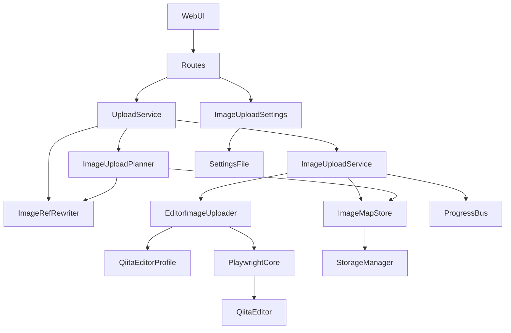
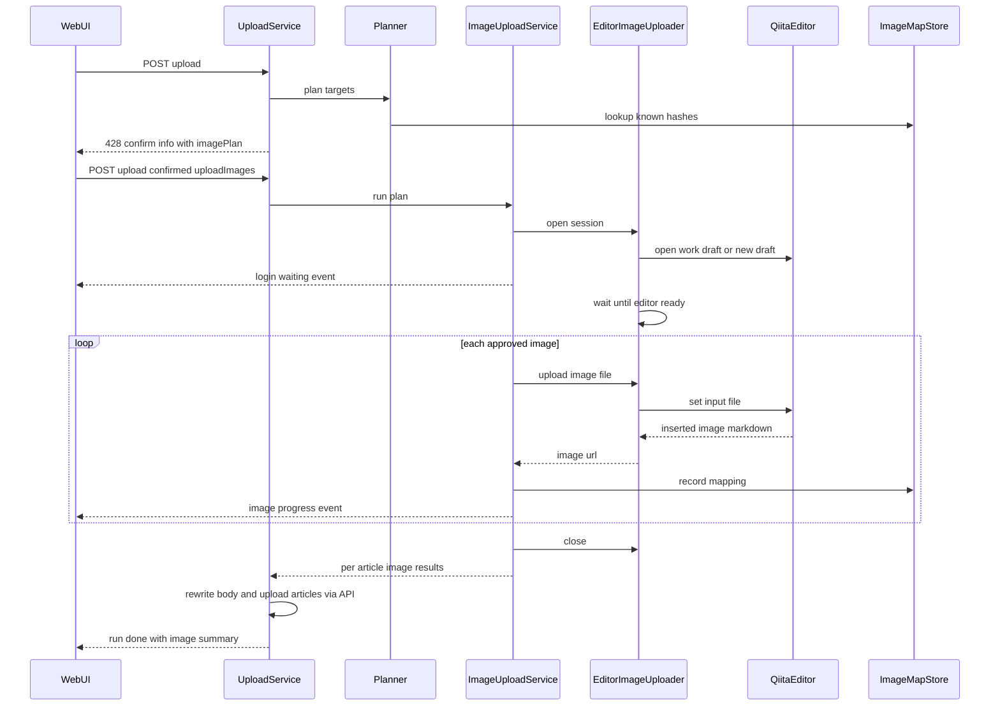
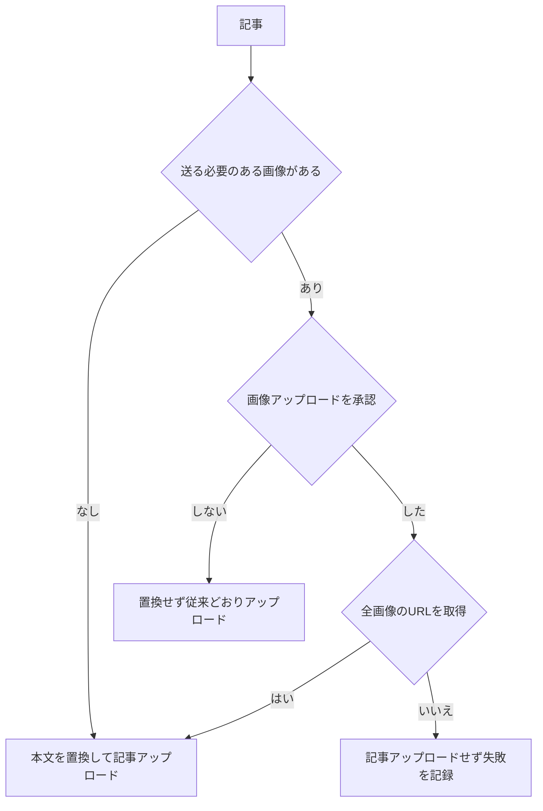

# Design Document — image-upload-automation

## Overview

**Purpose**: 記事アップロード(article-upload-sync)の前段で、記事本文が参照するローカル画像をQiitaへ自動アップロードし、Qiitaが発行した画像URLで送信本文の画像参照を置き換える。Qiita API v2 に画像アップロード手段がないため、ツールが起動した画面ありブラウザでQiitaのエディタ画面を操作する。

**Users**: ローカルで画像付きの記事を書き、Qiitaへ限定共有で登録・更新する執筆者。画像のドラッグとURLのコピーを手作業で行う手間をなくす。

**Impact**: 既存のアップロードRunに「画像フェーズ」を任意で差し込む。本機能を有効化しない場合、または実行前確認で画像アップロードを承認しない場合、アップロードの挙動は従来と変わらない。プロジェクトの基本方針(Qiita API v2 のみ・Web画面を自動操作しない)に対する、画像アップロードに限定した例外になる。

### Goals
- 承認されたローカル画像を1枚ずつQiitaへ送り、URLを取得して送信本文を置換する
- 画像とURLの対応を記録し、同じ内容の画像を二度送らない
- 画面変更などで自動化が壊れたとき、安全に止まって手動手順へ案内する
- パスワードを扱わず、セッションは既定で残さない

### Non-Goals
- ログイン操作の自動化、Qiita画面上での記事の保存・投稿・公開・設定変更
- 作業用下書きの自動削除
- Qiitaの内部API・セッションCookieを直接使う通信
- 画像の加工(リサイズ・圧縮・形式変換)
- バックアップ(ダウンロード)方向の挙動変更

## Boundary Commitments

### This Spec Owns
- ローカル画像参照の検出・解決・検証と、アップロード計画(`ImageUploadPlan`)
- 送信本文の画像参照の置換(純粋関数)
- 画像とQiita画像URLの対応表(`meta.json.uploadedImages` と新規記事フォルダの `.image-uploads.json`)
- Qiitaエディタ画面を操作するブラウザアダプタと、画面要素の定義(`qiitaEditorProfile`)
- 画像アップロード機能の設定(有効化・同意・セッション保存・作業用下書きURL)とその保存先 `.image-upload/`
- 画像フェーズの進捗イベントと結果サマリの項目

### Out of Boundary
- 記事の登録・更新のAPI呼び出し、対象選定、競合判定(article-upload-sync が所有。本スペックは送信本文を差し替えるだけ)
- Run排他の仕組み(`RunCoordinator`)、index保存・Gitコミットの実装
- 画像のダウンロードと閲覧用mdの相対パス化(qiita-backup-tool が所有)

### Allowed Dependencies
- `services` 層から: `StorageManager`, `ProgressBus`, `RunCoordinator`(既存のリースを共有)、新設の `ImageMapStore`, `EditorImageUploader`(いずれもインターフェース経由)
- `infra` 層から: `playwright-core`(任意依存、動的 import。`browserImageUploader.ts` 以外から import しない)
- 依存方向は既存どおり `http → services → infra → config / types`。`EditorImageUploader` は `TokenStore` に依存しない(11.2)

### Revalidation Triggers
- `ArticleMeta` のスキーマ変更(`uploadedImages` の形)— バックアップ側の `saveArticle` と状態判定に影響する
- `UploadStartRequest` / `UploadConfirmInfo` / `RunSummary` / `ProgressEvent` の形の変更 — フロントエンドと既存テストに影響する
- 新規記事フォルダの作成規約の変更(`.image-uploads.json` の扱い)— `LocalArticleScanner` に影響する
- Qiitaエディタ画面の変更 — `qiitaEditorProfile` の更新と実ブラウザ確認が必要

## Architecture

### Existing Architecture Analysis
- `UploadServiceImpl.start()` は「対象選定 → 実行前確認情報の返却(428) → `confirmed: true` で実行」の2段階で動く。画像の計画はこの実行前確認情報に追加する
- `executeRun()` は記事を直列処理し、どの終了経路でも index 保存+Gitコミットを行う。画像フェーズはこの記事ループの直前に入れる
- 既存の `meta.json.images`(`ImageResult[]`)と `restoreImageRefs()` は、ダウンロードした画像の対応表として機能している。アップロード側の対応表は別フィールドに持ち、両方を置換に使う
- `StorageManager.saveArticle()` / `normalizeDraft()` は meta を毎回作り直す。`uploadedImages` を引き継ぐよう改修する

### Architecture Pattern & Boundary Map

ポート&アダプタ構成とする。ブラウザ操作は `EditorImageUploader` インターフェースの裏に閉じ込め、サービス層は Playwright を知らない。



**Architecture Integration**:
- Selected pattern: ポート&アダプタ。画面変更時の修正を infra の2ファイル(アダプタとプロファイル)に限定し、偽アダプタでサービスをテストできるようにする
- Domain/feature boundaries: 「何を送るか」は Planner、「どう送るか」は Uploader、「何を記録するか」は MapStore、「本文をどう変えるか」は Rewriter が担う
- Existing patterns preserved: `Result<T, E>`、`kind` 判別子のエラー、`Deps` 型によるDI、`XxxImpl` / `createXxx()`、ファイル先頭の責務JSDoc
- New components rationale: 各コンポーネントの責務は「Components and Interfaces」を参照
- Steering compliance: 層の依存方向を守る。Webサーバはループバックのみのまま。トークンはブラウザに渡さない。方針の例外は steering に明記する(後述「Migration Strategy」)

### Technology Stack

| Layer | Choice / Version | Role in Feature | Notes |
|-------|------------------|-----------------|-------|
| Frontend | 既存(TS+esbuild) | 設定パネル・実行前確認の画像欄・ログイン待機表示 | 新規ファイルは作らず `main.ts` / `index.html` を拡張 |
| Backend / Services | 既存(Node.js 24, Express 5) | 画像フェーズの統括、設定API | 変更なし |
| Browser Automation | `playwright-core` 1.64系(実装時点の安定版に固定) | 画面ありブラウザの起動、ファイル投入、エディタ本文の読み取り | **新規の任意依存**(`optionalDependencies`)。ブラウザ本体は同梱せず、既存の Edge(`msedge`)→ Chrome(`chrome`)の順で起動する |
| Data / Storage | `meta.json`、`.image-uploads.json`、`.image-upload/settings.json` | 対応表と設定の永続化 | `.image-upload/` は Git 管理外 |

## File Structure Plan

### Directory Structure
```
src/
├── infra/
│   ├── qiitaEditorProfile.ts     # Qiitaエディタの画面定義(URL・セレクタ・画像URLの許可ホスト)を集約。画面変更時はここを直す
│   ├── browserImageUploader.ts   # EditorImageUploader の Playwright 実装。playwright-core を import する唯一のファイル
│   ├── imageMapStore.ts          # 画像↔URL対応表の読み書き(既存記事=meta.json、新規記事=.image-uploads.json)
│   └── imageUploadSettingsStore.ts # .image-upload/settings.json の読み書きと、保存済みセッションの削除
├── services/
│   ├── imageRefRewriter.ts       # ローカル画像参照の抽出・置換(純粋関数)。uploadService の extractLocalImageRefs を移設
│   ├── imageUploadPlanner.ts     # 対象記事から ImageUploadPlan を作る(参照解決・検証・ハッシュ・再利用判定)
│   └── imageUploadService.ts     # 画像フェーズの統括(ブラウザ起動→ログイン待機→投入→記録→後始末)
tests/
├── imageRefRewriter.test.ts
├── imageUploadPlanner.test.ts
├── imageMapStore.test.ts
├── imageUploadService.test.ts    # 偽 EditorImageUploader を使用
├── browserImageUploader.test.ts  # 模擬エディタ画面+実ブラウザ。ブラウザがない環境ではスキップ
└── helpers/
    ├── fakeEditorImageUploader.ts
    └── mockQiitaEditor.ts        # input[type=file] と CodeMirror 相当の本文を持つ模擬エディタ画面
```

### Modified Files
- `src/types/index.ts` — 本機能の型を追加し、`ArticleMeta`・`UploadStartRequest`・`UploadConfirmInfo`・`RunSummary` を拡張する
- `src/services/uploadService.ts` — 実行前確認に画像計画を追加し、`executeRun` に画像フェーズを差し込む。送信本文の置換に Rewriter を使う。`extractLocalImageRefs` は Rewriter から再エクスポートする
- `src/services/progressBus.ts` — 画像フェーズのイベントを `ProgressEvent` に追加する
- `src/infra/storageManager.ts` — `saveArticle` が既存 meta の `uploadedImages` を引き継ぐ。`normalizeDraft` が `.image-uploads.json` を meta に移して削除する
- `src/http/routes.ts` — 設定API(`/api/image-upload/*`)を追加し、`POST /api/upload` が `uploadImages` を受け取る
- `src/http/server.ts` — 新しいコンポーネントを組み立てる
- `src/web/index.html`, `src/web/main.ts`, `src/web/styles.css` — 設定パネル、実行前確認の画像欄、ログイン待機・画像進捗の表示、結果サマリの画像欄
- `package.json` — `optionalDependencies` に `playwright-core` を追加する
- `.gitignore` — `.image-upload/` を追加する
- `.kiro/steering/qiita-api.md`, `tech.md`, `security.md`, `structure.md` — 例外と新しい秘密情報の扱いを追記する
- `README.md`, `README.ja-JP.md` — 有効化手順、同意事項、`.image-uploads.json` の説明

## System Flows

### 画像フェーズを含むアップロードRun



**Key Decisions**:
- 画像フェーズは記事ループの前に一括で行う。ブラウザの起動とログインは1Runにつき1回で済む
- 画像フェーズ中の中断・ログイン待機の失敗(4.4, 4.5)では、記事アップロードを1件も行わない
- 画面要素が見つからない場合(8.1)は画像フェーズを中止する。新しい画像を必要としない記事(画像なし・すべて再利用)だけ、記事アップロードを続ける(8.4)

### 記事ごとの判定



- 「送る必要のある画像」は、対応表で再利用できない画像を指す。再利用できる画像だけの記事は、承認の有無にかかわらず置換して送る(既存の `restoreImageRefs` と同じく、記録済みの対応を使う)
- 承認しない場合、送る必要のある画像は置換されず、既存のローカル画像警告(article-upload-sync 8.3)がそのまま表示される(3.4)

## Requirements Traceability

| Requirement | Summary | Components | Interfaces | Flows |
|-------------|---------|------------|------------|-------|
| 1.1 | 既定で無効 | ImageUploadSettingsStore | `ImageUploadSettings.enabled` | — |
| 1.2 | 無効時は従来どおり | UploadService | `UploadConfirmInfo.imagePlan` 省略 | 記事ごとの判定 |
| 1.3 | 実行環境なしは利用不可 | BrowserImageUploader | `availability()` | — |
| 1.4 | 初回有効化時の同意 | Routes, WebUI | `PUT /api/image-upload/settings` | — |
| 2.1, 2.2 | 参照の検出・外部URL除外 | ImageRefRewriter | `extractLocalImageRefs()` | — |
| 2.3, 2.4, 2.5 | 欠落・フォルダ外・形式/容量 | ImageUploadPlanner | `ImagePlanEntry.status` | — |
| 2.6 | 記録済みは再利用 | ImageUploadPlanner, ImageMapStore | `findByHash()` | — |
| 3.1, 3.2 | 確認画面の提示内容 | UploadService, WebUI | `UploadConfirmInfo.imagePlan` | Run全体 |
| 3.3, 3.4 | 承認なしでは送らない | UploadService | `UploadStartRequest.uploadImages` | 記事ごとの判定 |
| 4.1〜4.3 | 画面ありブラウザと手動ログイン | ImageUploadService, BrowserImageUploader | `open()`, `waitUntilReady()` | Run全体 |
| 4.4, 4.5 | タイムアウト・閉じる・中断 | ImageUploadService | `ImagePhaseError` | Run全体 |
| 5.1〜5.3 | セッションの保存と削除 | BrowserImageUploader, ImageUploadSettingsStore | `persistSession`, `DELETE /api/image-upload/session` | — |
| 5.4 | セッション情報を出さない | BrowserImageUploader | ログ規律 | — |
| 6.1, 6.2 | 1枚ずつ投入しURL取得 | BrowserImageUploader | `uploadImage()` | Run全体 |
| 6.3 | 許可ホスト以外は失敗 | QiitaEditorProfile, ImageUploadService | `isAllowedImageUrl()` | — |
| 6.4 | 1枚ごとのタイムアウト | BrowserImageUploader | `imageTimeoutMs` | — |
| 6.5 | 進捗表示 | ImageUploadService, ProgressBus | `image-progress` | Run全体 |
| 6.6 | 中断 | ImageUploadService | `CancelToken` | Run全体 |
| 6.7 | 保存・投稿・公開をしない | BrowserImageUploader | 操作範囲の制約 | — |
| 7.1, 7.2 | 送信本文の置換 | ImageRefRewriter, UploadService | `rewriteImageRefs()` | 記事ごとの判定 |
| 7.3 | 閲覧用mdを保つ | UploadService, StorageManager | 閲覧用mdは書き換えない | — |
| 7.4, 7.6, 7.7 | 対応表の記録と再利用 | ImageMapStore, ImageUploadPlanner | `UploadedImageEntry` | — |
| 7.5 | 新規記事の引き継ぎ | StorageManager, ImageMapStore | `normalizeDraft()` | — |
| 8.1 | 画面要素の不在で中止 | BrowserImageUploader, ImageUploadService | `editorUnavailable` | Run全体 |
| 8.2〜8.4 | 部分失敗の扱い | UploadService | `ArticleImageResult` | 記事ごとの判定 |
| 8.5 | 予期しないエラー | ImageUploadService | `finally` で `close()` | — |
| 9.1 | 作業用下書きを最小限に | ImageUploadService, ImageUploadSettingsStore | `workDraftUrl` | — |
| 9.2 | 下書きの通知 | UploadService, WebUI | `RunSummary.imageUpload.workDraftUrl` | — |
| 9.3 | 下書きに記事内容を書かない | BrowserImageUploader | 1枚ごとにエディタを空にする | — |
| 10.1〜10.4 | Runへの統合 | UploadService | 既存リース・コミット | Run全体 |
| 11.1 | Qiita以外へ遷移しない | BrowserImageUploader, QiitaEditorProfile | `isQiitaUrl()` | — |
| 11.2 | トークンを渡さない | BrowserImageUploader | Deps に TokenStore を含めない | — |
| 11.3 | ログの限定 | 全コンポーネント | ログ規律 | — |
| 11.4 | ループバック維持 | server.ts | 変更なし | — |

## Components and Interfaces

| Component | Domain/Layer | Intent | Req Coverage | Key Dependencies (P0/P1) | Contracts |
|-----------|--------------|--------|--------------|--------------------------|-----------|
| ImageRefRewriter | services(純粋関数) | 画像参照の抽出と置換 | 2.1, 2.2, 7.1, 7.2 | なし | Service |
| ImageUploadPlanner | services | 送る画像の計画を作る | 2.3〜2.6, 3.1, 7.6, 7.7 | ImageMapStore (P0), StorageManager (P1) | Service |
| ImageUploadService | services | 画像フェーズを統括する | 4.x, 6.x, 8.1, 8.5, 9.1 | EditorImageUploader (P0), ImageMapStore (P0), ProgressBus (P1), ImageUploadSettingsStore (P1) | Service, Event |
| EditorImageUploader / BrowserImageUploader | infra | Qiitaエディタへの画像投入 | 1.3, 4.1〜4.3, 5.x, 6.1〜6.4, 6.7, 8.1, 9.3, 11.1〜11.3 | playwright-core (P0), QiitaEditorProfile (P0) | Service |
| QiitaEditorProfile | infra(定数) | 画面定義の集約 | 6.3, 8.1, 11.1 | なし | State |
| ImageMapStore | infra | 対応表の永続化 | 7.4, 7.5, 8.2 | StorageManager (P0) | Service, State |
| ImageUploadSettingsStore | infra | 機能設定の永続化 | 1.1, 1.4, 5.1〜5.3, 9.1 | なし | Service, State |
| UploadService(拡張) | services | 確認情報と画像フェーズの組み込み | 1.2, 3.x, 7.1, 7.3, 8.2〜8.4, 9.2, 10.x | ImageUploadPlanner (P0), ImageUploadService (P0) | Service |
| Routes(拡張) | http | 設定APIと承認フラグ | 1.4, 3.3, 5.3 | ImageUploadSettingsStore (P0) | API |
| WebUI(拡張) | web | 設定・確認・進捗・結果の表示 | 1.4, 3.1, 3.2, 4.3, 6.5, 9.2 | Routes | — |

### services

#### ImageRefRewriter

| Field | Detail |
|-------|--------|
| Intent | 本文からローカル画像参照を抽出し、対応表に従って置換する |
| Requirements | 2.1, 2.2, 7.1, 7.2 |

**Responsibilities & Constraints**
- Markdown画像記法(``)と imgタグ(``)を対象にする
- スキーム付きURL・`//` 始まり・`#` 始まりは外部参照として扱い、抽出も置換もしない
- 置換するのはパス部分だけで、代替テキスト・title・imgタグの他の属性は1文字も変えない
- コードブロック(``` で囲まれた範囲とインラインコード)の中は対象外にする

**Contracts**: Service [x]

##### Service Interface
```typescript
/** 本文中のローカル画像参照(出現順・重複なし)。ref は本文に書かれたままの文字列 */
export function extractLocalImageRefs(markdown: string): string[];

/** ref → URL の対応で置換する。対応にない ref は変更しない */
export function rewriteImageRefs(markdown: string, mapping: ReadonlyMap<string, string>): string;
```
- Postconditions: `rewriteImageRefs(md, 空のMap) === md`。置換後の本文と元の本文の差分は、画像参照のパス部分だけになる

#### ImageUploadPlanner

| Field | Detail |
|-------|--------|
| Intent | アップロード対象記事ごとに、送る画像・再利用する画像・送れない画像を決める |
| Requirements | 2.3, 2.4, 2.5, 2.6, 3.1, 7.6, 7.7 |

**Responsibilities & Constraints**
- ref を記事フォルダ基準のパスとして解決する(URLデコードし、クエリ・フラグメントを除く)
- 実体のパス(シンボリックリンク解決後)が記事フォルダの外なら `outsideFolder` とする
- 形式は拡張子と先頭バイトで判定する。許可する形式と1ファイルの上限容量は `QiitaEditorProfile` の定数を使う(上限の現行値は実装時に確認する — research.md)
- 内容の SHA-256 で対応表を引き、同じ内容が記録済みなら `reuse` とする。パスが同じでも内容が変わっていれば `upload` とする(7.6)
- ファイルの読み取りだけを行い、何も書き込まない

**Dependencies**
- Outbound: ImageMapStore — 記事ごとの対応表の参照 (P0)
- Outbound: StorageManager — バックアップルートの解決 (P1)

**Contracts**: Service [x]

##### Service Interface
```typescript
export interface ImageUploadPlanner {
  plan(targets: PlanTarget[]): Result<ImageUploadPlan, StorageError>;
}

/** 既存記事は id+folderName、新規記事は local キー+folderName と送信予定の本文 */
export type PlanTarget = {
  key: string;
  title: string;
  folderName: string;
  /** 置換前の送信本文(新規=frontmatter除去後の本文、更新=restoreImageRefs 後の本文) */
  body: string;
};
```
- Postconditions: 各 `PlanTarget` に対して `ArticleImagePlan` が1件ずつ作られる。同じRun内で同じ内容の画像が複数の記事・参照にあっても、`upload` は1回分として数える

#### ImageUploadService

| Field | Detail |
|-------|--------|
| Intent | ブラウザの起動からログイン待機・画像投入・記録・後始末までの画像フェーズを統括する |
| Requirements | 4.1〜4.5, 6.1〜6.6, 8.1, 8.3, 8.5, 9.1 |

**Responsibilities & Constraints**
- 呼び出し元(UploadService)が保持するRunリースの中でだけ動く。自分ではリースを取らない(10.1)
- 承認された計画の `upload` エントリを内容ハッシュ単位で1回ずつ送り、得たURLを該当するすべての記事の対応表に記録する
- 取得したURLが `isAllowedImageUrl()` を満たさなければ失敗とし、記録しない(6.3)
- URLは得られた時点で1件ずつ対応表へ書く。中断・失敗しても成功分は残る(6.6, 8.2)
- 中断の指示は画像1枚の処理の区切りで確かめる(6.6)
- どの終了経路でもブラウザを閉じ、セッションを保存しない設定なら一時プロファイルを削除する(8.5, 10.4, 5.1)
- 作業用下書きのURLを設定に記録し、次回はその下書きを開く(9.1)

**Dependencies**
- Outbound: EditorImageUploader — ブラウザ操作 (P0)
- Outbound: ImageMapStore — 対応表の記録 (P0)
- Outbound: ProgressBus — 画像フェーズのイベント (P1)
- Outbound: ImageUploadSettingsStore — セッション保存設定・作業用下書きURL (P1)

**Contracts**: Service [x] / Event [x]

##### Service Interface
```typescript
export interface ImageUploadService {
  run(plan: ImageUploadPlan, cancel: CancelToken): Promise<Result<ImagePhaseResult, ImagePhaseError>>;
}

export type CancelToken = { readonly cancelled: boolean };

export type ImagePhaseResult = {
  /** 記事キー → 記事の画像の状態(置換用の対応を含む) */
  articles: Map<string, ArticleImageResult>;
  uploaded: number;
  reused: number;
  failed: ImageFailureEntry[];
  workDraftUrl: string | null;
};

export type ArticleImageResult =
  | { ok: true; mapping: Map<string, string> } // ref → URL(再利用分を含む)
  | { ok: false; failedRefs: string[] };

/** 画像フェーズ全体の中止。記事アップロードをどこまで続けるかは UploadService が判断する */
export type ImagePhaseError =
  | { kind: "browserUnavailable"; message: string }        // 1.3
  | { kind: "loginTimeout" }                               // 4.4
  | { kind: "browserClosed" }                              // 4.4
  | { kind: "cancelledBeforeUpload" }                      // 4.5
  | { kind: "editorUnavailable"; missing: string; partial: ImagePhaseResult } // 8.1
  | { kind: "cancelled"; partial: ImagePhaseResult }       // 6.6
  | { kind: "unexpected"; message: string; partial: ImagePhaseResult }; // 8.5
```
- Preconditions: 呼び出し元がアップロードRunのリースを保持している。`plan` は実行前確認で利用者に提示したものと同じ
- Postconditions: 戻った時点でブラウザは閉じている。成功したURLは対応表に記録済み
- Invariants: 1回の `run` でブラウザの起動とログインは高々1回

##### Event Contract
- Published events(`ProgressEvent` に追加):
  - `{ type: "image-login-waiting"; timeoutAt: string }` — ログイン待機の開始(4.3)
  - `{ type: "image-progress"; done: number; total: number; currentName: string }` — 1枚ごとの前後(6.5)
  - `{ type: "image-done"; name: string; ok: boolean; reason?: string }` — 1枚の結果
- Ordering: `run-start` の後、既存の記事 `progress` より前に送る

**Implementation Notes**
- Integration: タイムアウトの既定値はログイン5分・1枚90秒。`Options` で差し替えられるようにする(テストを短くするため)
- Validation: 中断・失敗・正常の各経路でブラウザが閉じることを、偽アダプタの呼び出し記録で確かめる
- Risks: 画像フェーズ中に利用者が別タブで記事を保存しても、ツールは関知しない(画面操作の範囲外)

### infra

#### EditorImageUploader / BrowserImageUploader

| Field | Detail |
|-------|--------|
| Intent | Qiitaエディタ画面を開き、ログイン完了を待ち、画像を1枚投入してURLを返す |
| Requirements | 1.3, 4.1, 4.2, 4.3, 5.1, 5.2, 5.4, 6.1〜6.4, 6.7, 8.1, 9.3, 11.1〜11.3 |

**Responsibilities & Constraints**
- `playwright-core` を動的 import する唯一のモジュール。import に失敗したら `availability()` は `unavailable` を返す
- 起動は画面ありで、`msedge` → `chrome` の順に試す。ユーザデータは、セッション保存ありなら `.image-upload/browser-profile/`、なしなら OS の一時ディレクトリに置く
- ツールが自ら遷移する先は `QiitaEditorProfile` の Qiita URL だけ。利用者がログインのため外部(GitHub等)へ移動するのは妨げない(11.1)
- ログイン完了は「現在のURLがエディタのURLに一致し、画像投入欄が存在する」ことで判定する
- 画像1枚の投入手順: エディタ本文を空にする → 投入前のURL集合を取る → `input[type=file]` へファイルを設定 → 本文に新しい許可ホストのURLが現れるまで待つ → URLを返す → 本文を空にする(9.3)
- 記事の保存・投稿・公開のボタンや、設定画面には一切触れない(6.7)
- ID・パスワードの入力欄には触れない。Cookie・ストレージの値を読まない・ログに出さない(4.2, 5.4)
- `TokenStore` に依存しない(11.2)

**Dependencies**
- External: playwright-core — ブラウザ操作 (P0)
- Outbound: QiitaEditorProfile — URL・セレクタ・許可ホスト (P0)

**Contracts**: Service [x]

##### Service Interface
```typescript
export interface EditorImageUploader {
  availability(): Promise<{ available: true } | { available: false; reason: string }>;
  open(options: OpenOptions): Promise<Result<EditorSession, UploaderError>>;
}

export type OpenOptions = {
  persistSession: boolean;
  /** 前回の作業用下書き(なければ新規作成画面を開く) */
  workDraftUrl: string | null;
};

export interface EditorSession {
  /** ログイン完了と画像投入欄の出現を待つ */
  waitUntilReady(timeoutMs: number, cancel: CancelToken): Promise<Result<void, UploaderError>>;
  uploadImage(absPath: string, timeoutMs: number): Promise<Result<string, UploaderError>>;
  /** 現在開いている作業用下書きのURL(自動保存後に確定する) */
  currentDraftUrl(): string | null;
  /** ブラウザを閉じ、一時プロファイルなら削除する。何度呼んでもよい */
  close(): Promise<void>;
}

export type UploaderError =
  | { kind: "launchFailed"; message: string }
  | { kind: "timeout" }
  | { kind: "closedByUser" }
  | { kind: "cancelled" }
  | { kind: "editorElementMissing"; element: string }
  | { kind: "noUrlObserved" };
```

**Implementation Notes**
- Integration: 一時プロファイルの削除は再帰的な `unlinkSync` で行う(この環境では `rmSync` の `force` 指定が黙って失敗する — tech.md)
- Validation: 模擬エディタ画面(`tests/helpers/mockQiitaEditor.ts`)に対して実ブラウザで動かす任意テストを用意する。ブラウザがなければスキップする
- Risks: CodeMirror の内部構造に依存した本文の読み書きは、画面変更で最も壊れやすい。読み書きの手段は `QiitaEditorProfile` に寄せる

#### QiitaEditorProfile

| Field | Detail |
|-------|--------|
| Intent | Qiitaエディタ画面について、自動化が前提とする事実を1か所にまとめる |
| Requirements | 6.3, 8.1, 11.1 |

**Contracts**: State [x]
- `newDraftUrl`: `https://qiita.com/drafts/new`
- `editorUrlPattern`: `/drafts/new` または `/drafts/{id}/edit`
- `selectors`: 画像投入欄(`input[type=file]`)、本文エディタ(`.cm-editor`)
- `isQiitaUrl(url)`: ホストが `qiita.com`
- `isAllowedImageUrl(url)`: `https:` かつホストが `qiita-image-store.s3.amazonaws.com` または `qiita-image-store.s3.{region}.amazonaws.com`
- `acceptedImageTypes` と `maxImageBytes`: 実装時に実際の挙動で確定する
- 2026-10-25 の観測内容(research.md)を根拠としてコメントに残す

#### ImageMapStore

| Field | Detail |
|-------|--------|
| Intent | 画像とQiita画像URLの対応表を、記事の種類に応じた場所へ読み書きする |
| Requirements | 7.4, 7.5, 7.6, 7.7, 8.2 |

**Responsibilities & Constraints**
- 既存記事(フォルダ名が `_{記事ID}` で終わる)は `meta.json.uploadedImages` を読み書きする
- 新規記事は記事フォルダ直下の `.image-uploads.json` を読み書きする
- 1件追加するたびに一時ファイル経由で書き込み、途中で止まっても既存の記録を壊さない
- 同じ `sha256` のエントリは1件にまとめ、参照パスの一覧を更新する

**Contracts**: Service [x] / State [x]

##### Service Interface
```typescript
export interface ImageMapStore {
  read(folderName: string): Result<UploadedImageEntry[], StorageError>;
  record(folderName: string, entry: UploadedImageEntry): Result<void, StorageError>;
  /** バックアップルート内の全記事から同じ内容の画像を探す(記事をまたいだ再利用) */
  findByHash(sha256: string): UploadedImageEntry | null;
}
```

#### ImageUploadSettingsStore

| Field | Detail |
|-------|--------|
| Intent | 画像アップロード機能の設定を `.image-upload/settings.json` に保存し、保存済みセッションを削除する |
| Requirements | 1.1, 1.4, 5.1, 5.2, 5.3, 9.1 |

**Contracts**: Service [x] / State [x]

##### Service Interface
```typescript
export interface ImageUploadSettingsStore {
  get(): ImageUploadSettings;
  update(patch: ImageUploadSettingsPatch): Result<ImageUploadSettings, StorageError>;
  /** browser-profile/ を削除し persistSession を false にする */
  clearSession(): Result<void, StorageError>;
  hasSavedSession(): boolean;
}
```
- Invariants: `enabled: true` は `consentedAt` が記録済みのときだけ成立する(1.4)。ファイルがなければ既定値(無効)を返す(1.1)
- 保存先 `.image-upload/` はプロジェクトルート直下に置き、`backups/` の外とする(5.2)

### services(拡張)

#### UploadService(拡張)

| Field | Detail |
|-------|--------|
| Intent | 実行前確認に画像計画を載せ、承認されたら画像フェーズを記事ループの前に実行する |
| Requirements | 1.2, 3.1〜3.4, 7.1, 7.3, 8.2〜8.4, 9.2, 10.1〜10.3 |

**Responsibilities & Constraints**
- 機能が有効かつ利用可能で、送る必要のある画像があるときだけ `UploadConfirmInfo.imagePlan` を付ける。無効なら従来と同じ確認情報を返す(1.2)
- `uploadImages: true` かつ `confirmed: true` のときだけ画像フェーズを実行する(3.3)
- 画像フェーズの結果で記事ごとに分岐する(「記事ごとの判定」の図)。`loginTimeout` / `browserClosed` / `cancelledBeforeUpload` / `cancelled` では記事アップロードを行わない(4.4, 4.5, 6.6)
- 送信本文は `rewriteImageRefs(送信予定の本文, mapping)` で作る。閲覧用mdには書き戻さない(7.3)
- 結果サマリに画像の件数・失敗・作業用下書きURLを載せる(9.2, 10.3)

**Contracts**: Service [x](既存の `UploadService` インターフェースは変えない。`start()` の入力 `UploadStartRequest` と出力の確認情報を拡張する)

### http

#### Routes(拡張)

**Contracts**: API [x]

##### API Contract
| Method | Endpoint | Request | Response | Errors |
|--------|----------|---------|----------|--------|
| GET | /api/image-upload/settings | — | `ImageUploadSettingsView` | — |
| PUT | /api/image-upload/settings | `{ enabled?: boolean; consent?: true; persistSession?: boolean }` | `ImageUploadSettingsView` | 400 `CONSENT_REQUIRED`(同意なしで有効化), 503 `IMAGE_UPLOAD_UNAVAILABLE` |
| DELETE | /api/image-upload/session | — | 204 | 409 `RUN_IN_PROGRESS` |
| POST | /api/upload(拡張) | 既存 + `uploadImages?: boolean` | 既存 | 既存 |

- `ImageUploadSettingsView` は `ImageUploadSettings` に `available` / `unavailableReason` / `hasSavedSession` を加えたもの。作業用下書きURLは表示用に含める
- 有効化(`enabled: true`)には、同じ要求か過去の要求での `consent: true` が必要(1.4)
- Run実行中の設定変更・セッション削除は 409 で拒否する

### web(拡張・サマリのみ)

- **設定パネル**: 有効化スイッチ、同意画面(非公式手段・画面変更で壊れ得ること・規約上の注意・アカウント凍結の可能性)、セッション保存の選択、保存済みセッションの削除ボタン、利用不可の理由と導入手順
- **実行前確認**: 既存のダイアログに「画像をQiitaへアップロードする」チェックと、記事ごとの画像一覧・枚数・合計容量・再利用件数・送れない画像と理由を追加する。3.2 の注意文を常に表示する。チェックがなければ既存のローカル画像警告を表示する
- **進捗**: ログイン待機中は「開いたブラウザでQiitaにログインしてください」と残り時間を表示する。画像フェーズの進捗は既存の進捗バーを使う
- **結果サマリ**: 画像の成功・失敗・再利用の件数、失敗した画像と理由、作業用下書きのURLと「削除はQiita上で行う」旨

## Data Models

### Logical Data Model

```typescript
/** 対応表の1件(7.4)。sha256 が同一性のキー */
export type UploadedImageEntry = {
  sha256: string;
  /** 記事フォルダ基準の相対パス(本文の ref を解決した結果。複数参照されることがある) */
  paths: string[];
  url: string;
  bytes: number;
  uploadedAt: string;
};

/** ArticleMeta の拡張(省略時は空配列として読む — 既存 meta との後方互換) */
export type ArticleMeta = ExistingArticleMeta & { uploadedImages?: UploadedImageEntry[] };

/** 新規記事フォルダの補助ファイル .image-uploads.json */
export type DraftImageUploads = { schemaVersion: 1; entries: UploadedImageEntry[] };

export type ImageUploadSettings = {
  schemaVersion: 1;
  enabled: boolean;
  consentedAt: string | null;
  persistSession: boolean;
  workDraftUrl: string | null;
};

export type ImagePlanEntry = {
  ref: string;
  /** 記事フォルダ基準の正規化パス(解決できた場合) */
  path: string | null;
  bytes: number | null;
  sha256: string | null;
  status:
    | { kind: "upload" }
    | { kind: "reuse"; url: string }
    | { kind: "missing" }                 // 2.3
    | { kind: "outsideFolder" }           // 2.4
    | { kind: "unsupported"; reason: string }; // 2.5
};

export type ArticleImagePlan = { key: string; title: string; folderName: string; entries: ImagePlanEntry[] };

export type ImageUploadPlan = {
  articles: ArticleImagePlan[];
  uploadCount: number;   // 内容ハッシュ単位
  uploadBytes: number;
  reuseCount: number;
};
```

**Consistency & Integrity**:
- 対応表は追記のみで、エントリの削除は行わない(Qiita側の画像は消せないため、記録を残す)
- `normalizeDraft` は `.image-uploads.json` の `entries` を新しい meta の `uploadedImages` に入れてから補助ファイルを削除する(7.5)。meta の書き込みに失敗した場合、補助ファイルは消さない
- `saveArticle`(バックアップ・更新アップロードの両方)は、既存 meta の `uploadedImages` をそのまま引き継ぐ

### Data Contracts & Integration

- `UploadStartRequest` に `uploadImages?: boolean` を追加する(省略時 false)
- `UploadConfirmInfo` に `imagePlan?: ImageUploadPlan` を追加する。`imageWarnings` は従来どおり返し、フロントエンドは `uploadImages` の選択に応じて表示を切り替える
- `RunSummary` に `imageUpload?: { uploaded: number; reused: number; failed: ImageFailureEntry[]; workDraftUrl: string | null; aborted: ImagePhaseError["kind"] | null }` を追加する。省略時は画像フェーズなし(既存履歴との後方互換)
- `ImageFailureEntry = { articleKey: string; articleTitle: string; ref: string; reason: string }`

## Error Handling

### Error Strategy
画像フェーズは「安全側に止まる」を原則とする。画像の欠けた記事を送らず、記事アップロードを続けるかどうかは失敗の種類で決める。

| 状況 | 画像フェーズ | 記事アップロード | 利用者への案内 |
|------|--------------|------------------|----------------|
| playwright-core を読めない・ブラウザ起動失敗(1.3) | 開始しない | 行わない(Run を失敗で終える) | 導入手順。画像アップロードを外せば従来どおり送れる旨 |
| ログインのタイムアウト・ブラウザを閉じた(4.4) | 中止 | 行わない | 再実行を案内 |
| ログイン待機中の中断(4.5) | 中止 | 行わない | — |
| 画面要素が見つからない(8.1) | 中止 | 新しい画像が不要な記事だけ行う | 画面変更の可能性と手動での画像アップロード手順 |
| 画像1枚の失敗(6.3, 6.4)| 続行 | その画像を含む記事は行わない(8.2) | 失敗した画像と理由 |
| 画像フェーズ中の中断(6.6) | 処理中の1枚の完了後に停止 | 行わない | 取得済みURLは保持した旨 |
| 予期しないエラー(8.5) | 中止しブラウザを閉じる | 行わない | Runを中断として記録 |

### Monitoring
- 既存のファイルロガーを使う。出力するのは画像ファイル名・記事キー・取得したURL・処理結果・エラー種別だけ(11.3)
- Cookie・ストレージの値・画像の内容・ブラウザのコンソール全文は出力しない

## Testing Strategy

- **Unit Tests**
  - ImageRefRewriter: Markdown記法とimgタグの抽出、外部URL・コードブロック内の除外、置換で代替テキスト・width属性が変わらないこと
  - ImageUploadPlanner: 欠落・フォルダ外(`../` とシンボリックリンク)・形式外・容量超過の判定、同一内容の再利用、内容変更時の再アップロード、同じ画像を複数記事が参照する場合の集約
  - ImageMapStore: 既存記事と新規記事の保存先の振り分け、同一ハッシュの統合、書き込み途中の失敗で既存記録が壊れないこと
  - ImageUploadSettingsStore: ファイルなしの既定値、同意なしの有効化拒否、セッション削除
- **Integration Tests**(偽 EditorImageUploader+既存のモックQiitaサーバ)
  - 承認あり: 画像フェーズ → 送信本文がURLに置換されて `createItem` / `updateItem` に渡り、閲覧用mdは変わらない
  - 承認なし・機能無効: 送信本文と確認情報が従来と同一
  - 1枚失敗: その記事だけ失敗し、他の記事は送られ、成功したURLは対応表に残る
  - ログインタイムアウト・中断: 記事アップロードが1件も行われず、ブラウザが閉じられる
  - 新規記事の登録: `.image-uploads.json` が meta の `uploadedImages` に引き継がれ、補助ファイルが消える。次回は再利用される
- **E2E(任意・実ブラウザ)**
  - 模擬エディタ画面に対して BrowserImageUploader を動かし、URLの取得とエディタを空にする動作を確かめる。Edge/Chrome がない環境ではスキップする
  - 実Qiitaへの接続テストは書かない(tech.md)。実画面での確認は手動の受け入れ手順として README に残す

## Security Considerations
- **新しい秘密情報**: ブラウザのセッション(Cookie等)。既定では一時プロファイルに置き、Run終了時に削除する。保存する場合も `.image-upload/browser-profile/` に限り、`.gitignore` に含め、`backups/` の外に置く。画面から削除できる
- **権限の分離**: ブラウザにはアクセストークンを渡さない。ブラウザ側のQiitaセッションとAPIトークンは独立している
- **操作範囲の限定**: ツールが自ら開くのは Qiita のエディタ画面だけ。保存・投稿・公開・設定変更の要素には触れない
- **規約リスク**: 初回有効化時に、Qiita利用規約(第11条・第12条)に照らした注意とアカウント凍結の可能性を提示し、同意を記録する
- **steering の例外**: `qiita-api.md` の「Web画面を自動操作しない」に、本機能を唯一の例外として追記する(Migration Strategy)

## Performance & Scalability
- 画像は直列で1枚ずつ送る(サーバ負荷への配慮と、URLの対応付けを確実にするため)。2026-10-25 の手動作業では1枚あたり数秒だった
- 同じ内容の画像は1Run内でも記事をまたいでも1回だけ送る
- 1Runで送る枚数・容量の上限は設けず、実行前確認で枚数と合計容量を示して利用者が判断する

## Migration Strategy
- **データ**: `meta.json.uploadedImages` は任意フィールドで、既存の meta はそのまま読める。移行処理は不要
- **依存**: `playwright-core` は `optionalDependencies` に入れる。インストールに失敗しても本体は動く
- **steering の改訂**(本設計の承認後、実装タスクの最初に行う)
  - `qiita-api.md`: 「Web画面の自動操作は行わない」に、画像アップロード(本スペック)を限定的な例外として追記する
  - `tech.md`: 任意依存 `playwright-core` と、ブラウザ操作を `browserImageUploader.ts` に閉じ込める規則を追記する
  - `security.md`: ブラウザセッションの取り扱い(既定で保存しない・保存先・削除手段)を追記する
  - `structure.md`: `.image-upload/` と `.image-uploads.json` の位置づけを追記する
- **文書**: 外部要件書(`docs/外部要件書.md`)への反映は、article-upload-sync と同じく本Kiroスペックで管理する方針とし、README に利用手順を追記する
