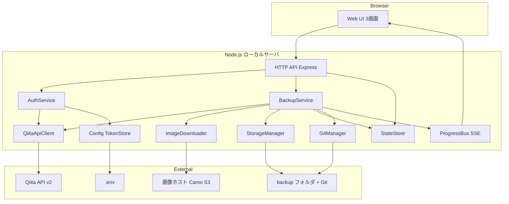
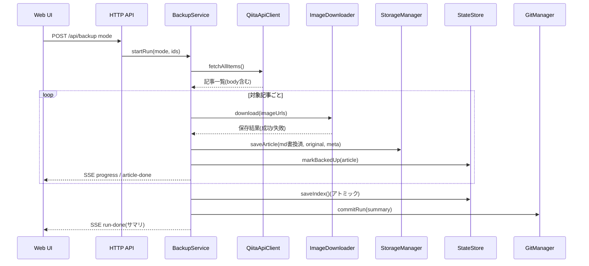

# Technical Design Document — qiita-backup-tool

## Overview

**Purpose**: 本機能は、Qiitaに投稿した個人の全記事(限定共有含む)のMarkdown本文と画像をローカルPCへ単方向バックアップする手段を記事作者に提供する。バックアップはMarkdownビューワでそのまま閲覧可能な形式で保存され、ローカルGitのコミット履歴として世代管理される。

**Users**: Qiita記事の作者(単一ユーザ・ローカル利用)が、ブラウザ上のWeb UIから接続確認・一覧確認・バックアップ実行・進捗確認のワークフローで利用する。

**Impact**: グリーンフィールド(新規開発)。既存システムへの変更はない。

### Goals
- Qiita API v2(個人用アクセストークン、`read_qiita`)による全記事+画像の取得と、相対パス書き換えによる自己完結したローカルMarkdownの生成
- `backups/index.json` による5状態の状態管理・更新検知と、`backups/` 独立GitリポジトリへのRun単位自動コミット
- localhost限定のWeb UI(接続確認/ダッシュボード/実行状況の3画面)
- 記事300件・画像10枚/記事の規模で30分以内の全件バックアップ(9.1)

### Non-Goals
- ローカル→Qiita方向の同期・復元投稿、Qiita Team・他ユーザの記事
- バックアップリポジトリのリモート同期(push/pull)、過去世代の閲覧・復元UI
- 定期実行スケジューラ、ローカルバックアップの自動削除、外部からのリンク数表示

## Boundary Commitments

### This Spec Owns
- Qiita API v2への読み取りアクセス(認証・一覧取得・レート制御)と画像ダウンロード
- `backups/` 配下の全ファイル(記事フォルダ、`index.json`、Gitリポジトリ)の生成・更新
- `.env` の `QIITA_ACCESS_TOKEN` 行の読み書き(F-AUTH-08の同意時のみ書き込み)
- ローカルHTTP API(`/api/*`)とWeb UIの契約

### Out of Boundary
- Qiita側のデータ(書き込み系APIは一切呼ばない)
- `backups/` リポジトリのリモート運用・復元操作(ユーザのGit操作に委ねる)
- `.env` の `QIITA_ACCESS_TOKEN` 以外のキーの管理(読み取りのみ)

### Allowed Dependencies
- Qiita API v2(`qiita.com`)および画像ホスト(`camo.qiitausercontent.com`、`qiita-image-store.s3.*`)
- ローカルの `git` CLI(不在時は世代管理なしで継続 — 6.6)
- `.kiro/steering/` の qiita-api / security / documentation-standards 規約

### Revalidation Triggers
- Qiita API v2のレスポンス形式・レート制限仕様の変更
- `index.json` / `meta.json` のスキーマ変更(バージョンフィールドで検知)
- HTTP API(`/api/*`)の契約変更
- 起動前提(Node.jsバージョン、git CLI)の変更

## Architecture

### Architecture Pattern & Boundary Map

採用パターン: **レイヤードモノリス**(単一Node.jsプロセス)。依存方向は `Types → Config → Infra → Service → HTTP → UI` の一方向とし、逆方向のimportは実装エラーとして扱う。パターン比較の経緯は `research.md` を参照。



**Key Decisions**:
- 認証ヘッダを付けるHTTPクライアント(QiitaApiClient)と付けないクライアント(ImageDownloader)を**別コンポーネントに分離**し、トークンが画像ホストへ漏れる経路を構造的に排除する(8.5)
- BackupServiceがRun(実行)単位のオーケストレーションを一手に担い、Git操作・状態更新・進捗通知はRunの境界でのみ発生する
- steering準拠: qiita-api.md(API利用パターン)、security.md(トークン規律)に従う

### Technology Stack

| Layer | Choice / Version | Role in Feature | Notes |
|-------|------------------|-----------------|-------|
| Frontend | 静的HTML + vanilla TypeScript(esbuildバンドル) | 3画面のUI、EventSourceによる進捗受信 | SPAフレームワーク不使用(画面3枚・状態少) |
| Backend | Node.js 24 LTS + TypeScript 5(strict) + Express 5.2 | HTTP API・静的配信・SSE | Node 24はActive LTS(EOL 2028-04) |
| Data / Storage | ファイルシステム(`backups/`)+ JSON(`index.json`/`meta.json`) | バックアップ実体と管理情報 | DBは使用しない |
| VCS統合 | simple-git 3.36 | `backups/` リポジトリのinit/add/commit | `git` CLI必須。不在時は警告+世代管理なし(6.6) |
| 設定 | dotenv + 自前の.env行更新ユーティリティ | トークン・ポート・バックアップ先の読込/保存 | 書き込みは `QIITA_ACCESS_TOKEN` 行のみ |

## File Structure Plan

### Directory Structure

```
src/
├── types/                  # 共有型定義(Article, BackupStatus, RunResult 等)— 依存最下層
├── config/
│   ├── env.ts              # .env 読込・QIITA_ACCESS_TOKEN行の安全な更新
│   └── tokenStore.ts       # トークンのメモリ保持(単一の真実)
├── infra/
│   ├── qiitaApiClient.ts   # Qiita API v2(Bearer付き)。一覧・ユーザ取得・レート制御
│   ├── imageDownloader.ts  # 画像GET(認証ヘッダなしの独立クライアント)
│   ├── storageManager.ts   # 記事フォルダ・meta.json・アトミック書込・フォルダ名生成
│   └── gitManager.ts       # simple-git ラッパ(init/commitRun/可用性判定)
├── services/
│   ├── authService.ts      # 接続確認・トークン検証・保存オーケストレーション
│   ├── stateStore.ts       # index.json 管理・5状態分類・履歴
│   ├── backupService.ts    # Run実行(全件/差分/選択)・中断・Markdown書換の統括
│   └── progressBus.ts      # Runイベントの発行(SSEへ中継)
├── http/
│   ├── server.ts           # Express起動(localhostバインド)・静的配信
│   └── routes.ts           # /api/* ルーティング(薄いコントローラ)
└── web/                    # フロント(index.html + 画面別TS。ビルド成果物をserverが配信)
```

- ログ出力先: `logs/app.log`(10.1)。バックアップ先: `backups/`(`.env` の `BACKUP_DIR` で変更可)
- `.gitignore`(ツール本体): `.env`, `backups/`, `logs/`, `node_modules/`, `dist/`

## System Flows

### バックアップ実行(Run)のシーケンス



- 中断(`POST /api/backup/cancel`)はRunのキャンセルフラグを立て、**処理中の記事の完了を待ってから**停止する(3.10)。完了済み記事とindex.jsonは保持し、Gitコミットも実行する(6.3)
- 429受信時はBackupServiceがQiitaApiClientの指示する待機時刻までRunを一時停止し、SSEで待機中である旨を通知する(3.12)
- Runは同時に1つのみ(排他)。実行中の再実行要求は409で拒否する

### 記事の状態分類(判定ロジック)

| 状態 | 判定条件(優先順) |
|---|---|
| Qiita側削除 | index.jsonに存在するがQiita一覧に存在しない |
| 未バックアップ | Qiita一覧に存在するがindex.jsonに存在しない |
| ローカル変更あり | 保存ファイルのハッシュがindex.json記録値と不一致、またはファイル欠落 |
| Qiita側更新あり | Qiitaの `updated_at` > index.jsonの `qiitaUpdatedAt` |
| バックアップ済(最新) | 上記いずれにも該当しない |

## Requirements Traceability

| Requirement | Summary | Components | Interfaces | Flows |
|-------------|---------|------------|------------|-------|
| 1.1, 1.2, 1.3 | トークン読込・検証・結果表示 | Config/TokenStore, AuthService, QiitaApiClient | `POST /api/connection/verify` | — |
| 1.4, 1.5 | 無効時の案内とトークン画面入力 | AuthService, Web UI(接続確認画面) | 同上(`token` パラメータ) | — |
| 1.6, 1.7 | `.env` 保存(同意時)/メモリのみ保持 | Config(env.ts), TokenStore | `save` フラグ | — |
| 1.8 | 接続状態の常時表示 | Web UI, AuthService | `GET /api/connection` | — |
| 2.1 | 全記事のページング取得 | QiitaApiClient | `fetchAllItems()` | Runシーケンス |
| 2.2, 2.3, 2.4, 2.5 | 一覧の保持項目・表示・絞込・フォルダを開く | StateStore, Web UI(ダッシュボード) | `GET /api/articles`, `POST /api/articles/:id/open-folder` | — |
| 3.1, 3.2, 3.3 | 全件/選択/差分の実行モード | BackupService | `POST /api/backup` | Runシーケンス |
| 3.4, 3.5, 3.6, 3.7 | Markdown保存・画像取得・相対パス書換・original併存 | BackupService, ImageDownloader, StorageManager | `saveArticle()` | Runシーケンス |
| 3.8 | 画像失敗時の継続 | ImageDownloader, BackupService | `ImageResult` | Runシーケンス |
| 3.9, 3.10 | 進捗表示・中断 | ProgressBus, BackupService | `GET /api/backup/events`(SSE), `POST /api/backup/cancel` | Runシーケンス |
| 3.11 | 再バックアップ時の上書き | StorageManager | `saveArticle()` | — |
| 3.12 | 429時の待機継続 | QiitaApiClient, BackupService | `RateLimitError` | Runシーケンス |
| 4.1–4.6 | フォルダ構成・命名・meta.json・リネーム | StorageManager | `ArticleMeta` スキーマ | — |
| 5.1–5.8 | index.json・5状態分類・確認・履歴 | StateStore | `IndexFile` スキーマ, `GET /api/history` | 状態分類表 |
| 6.1–6.8 | Git初期化・`backup`ブランチへのコミット(ローカル専用)・縮退運転 | GitManager, BackupService | `commitRun()` | Runシーケンス |
| 7.1–7.5 | サーバ起動・3画面UI | server.ts, Web UI | 静的配信 + `/api/*` | — |
| 8.1–8.5 | トークン保護・localhost限定・ヘッダ分離 | TokenStore, ImageDownloader, server.ts | — | — |
| 9.1–9.3 | 30分以内・リトライ・アトミック書込 | BackupService, StateStore | `RetryPolicy` | — |
| 10.1–10.3 | ログ・Windows 11・単一コマンド起動 | server.ts, logger | `logs/app.log` | — |

## Components and Interfaces

| Component | Domain/Layer | Intent | Req Coverage | Key Dependencies | Contracts |
|-----------|--------------|--------|--------------|------------------|-----------|
| Config / TokenStore | Config | .env読込とトークンのメモリ管理・保存 | 1.1, 1.6, 1.7 | .env(P0) | Service |
| QiitaApiClient | Infra | Qiita API v2アクセスとレート制御 | 1.2, 2.1, 3.12 | Qiita API(P0), TokenStore(P0) | Service |
| ImageDownloader | Infra | 認証なし画像取得 | 3.5, 3.8, 8.5 | 画像ホスト(P1) | Service |
| StorageManager | Infra | 記事フォルダ・ファイルの物理管理 | 3.11, 4.1–4.6, 9.3 | ファイルシステム(P0) | Service |
| GitManager | Infra | backupリポジトリのinit/commit(`backup`ブランチ固定・ローカル専用) | 6.1–6.8 | git CLI(P1), simple-git(P0) | Service |
| AuthService | Service | 接続確認のオーケストレーション | 1.2–1.8 | QiitaApiClient(P0), TokenStore(P0) | Service |
| StateStore | Service | index.json・状態分類・履歴 | 2.2, 5.1–5.8 | StorageManager(P0) | Service, State |
| BackupService | Service | Run実行・中断・書換の統括 | 3.1–3.12, 6.3, 9.1–9.2 | 全Infra(P0), ProgressBus(P0) | Service, Event |
| ProgressBus | Service | Runイベント発行 | 3.9, 7.4 | — | Event |
| HTTP API | HTTP | REST+SSEの提供、localhost限定 | 7.1, 8.3 | 全Service(P0) | API |
| Web UI | UI | 3画面(接続確認/ダッシュボード/実行状況) | 1.4, 1.8, 2.3–2.5, 7.2–7.5 | HTTP API(P0) | — |

UIは新しい境界を持たないためサマリのみとする(SVGワイヤーフレーム screen-01〜03 が画面仕様)。以下、境界を持つコンポーネントの詳細を示す。

### Config

#### Config / TokenStore

| Field | Detail |
|-------|--------|
| Intent | `.env` の読込・`QIITA_ACCESS_TOKEN` 行の安全な更新と、トークンのメモリ保持 |
| Requirements | 1.1, 1.6, 1.7, 8.1, 8.2 |

**Responsibilities & Constraints**
- トークンの「単一の真実」はメモリ(TokenStore)。`.env` は起動時読込と同意時書込のみ
- `.env` 書込は既存内容を保持し `QIITA_ACCESS_TOKEN` 行のみ置換/追記(BOMなしUTF-8)
- トークン全文をログ・レスポンスに出さない。マスクは末尾4桁のみ

**Contracts**: Service [x]

```typescript
interface TokenStore {
  get(): string | null;
  set(token: string): void;                    // メモリのみ
  maskedTail(): string | null;                 // 例: "****8d5a"
}
interface EnvConfig {
  load(): AppConfig;                           // 起動時1回
  persistToken(token: string): Result<void, EnvWriteError>; // 1.6 同意時のみ
}
type AppConfig = { backupDir: string; serverPort: number; tokenFromEnv: string | null };
```
- Preconditions: `persistToken` はトークン検証成功後にのみ呼ばれる
- Postconditions: `.env` の他キー・コメントは保持される

### Infra

#### QiitaApiClient

| Field | Detail |
|-------|--------|
| Intent | Qiita API v2の呼び出し(Bearer付与)・ページング追跡・レート制御 |
| Requirements | 1.2, 2.1, 3.12 |

**Responsibilities & Constraints**
- 呼び出すのは `GET /authenticated_user` と `GET /authenticated_user/items` のみ(steering qiita-api.md)
- `Link` ヘッダ `rel="next"` で全ページ追跡、`per_page=100`
- `Rate-Remaining` / `Rate-Reset` を監視し、429時は待機時刻を呼び出し元へ返す(実ヘッダ名は実装初期に確認)

**Dependencies**
- Outbound: Qiita API v2 — 記事・ユーザ取得(P0)
- Inbound: AuthService, BackupService(P0)

**Contracts**: Service [x]

```typescript
interface QiitaApiClient {
  verifyToken(token: string): Promise<Result<AuthenticatedUser, ApiError>>;
  fetchAllItems(onPage?: (fetched: number, total: number) => void): Promise<Result<QiitaItem[], ApiError>>;
}
type AuthenticatedUser = { id: string; itemsCount: number };
type QiitaItem = {
  id: string; title: string; body: string; url: string;
  createdAt: string; updatedAt: string; private: boolean;
  tags: { name: string }[];
  commentsCount: number; likesCount: number; stocksCount: number;
};
type ApiError =
  | { kind: "unauthorized" }              // 401
  | { kind: "forbidden" }                 // 403
  | { kind: "rateLimited"; resetAt: Date } // 429 → 3.12
  | { kind: "network"; cause: string }
  | { kind: "server"; status: number };
```

#### ImageDownloader

| Field | Detail |
|-------|--------|
| Intent | Markdown中の画像URLの抽出と、認証ヘッダなしでのダウンロード |
| Requirements | 3.5, 3.8, 4.4, 8.5 |

**Responsibilities & Constraints**
- QiitaApiClientとHTTPクライアントを共有しない(`Authorization` 漏洩の構造的防止 — 8.5)
- 抽出対象: `` と ``。同一URLは1回のみ取得
- ファイル名は登場順連番+元ファイル名(なければ連番のみ)、拡張子はContent-Typeから決定
- 直列ダウンロード+300ms間隔(サーバ負荷配慮)。失敗は記録して継続(3.8)

**Contracts**: Service [x]

```typescript
interface ImageDownloader {
  extractImageUrls(markdown: string): string[];
  downloadAll(urls: string[], destDir: string): Promise<ImageResult[]>;
}
type ImageResult =
  | { url: string; ok: true; fileName: string }
  | { url: string; ok: false; reason: string };
```

#### StorageManager

| Field | Detail |
|-------|--------|
| Intent | 記事フォルダの物理レイアウト管理とアトミック書込 |
| Requirements | 3.4, 3.6, 3.7, 3.11, 4.1–4.6, 9.3 |

**Responsibilities & Constraints**
- フォルダ名 `{サニタイズ済タイトル(最大50文字)}_{記事ID}`。禁止文字は `_` に置換
- 記事IDが一致する既存フォルダ名と異なる場合はリネーム(4.6)
- JSON書込は write-then-rename でアトミックに行う(9.3)
- `backups/` 配下以外への書込を拒否する(パストラバーサル防止)

**Contracts**: Service [x]

```typescript
interface StorageManager {
  saveArticle(article: QiitaItem, rewrittenMd: string, images: ImageResult[]): Promise<Result<ArticlePaths, StorageError>>;
  writeJsonAtomic<T>(relPath: string, data: T): Promise<Result<void, StorageError>>;
  openFolder(articleId: string): Result<void, StorageError>;  // explorer.exe 起動(2.5)
}
type ArticlePaths = { dir: string; viewMd: string; originalMd: string; metaJson: string };
```

#### GitManager

| Field | Detail |
|-------|--------|
| Intent | `backups/` 独立Gitリポジトリの初期化とRun単位コミット |
| Requirements | 6.1–6.8 |

**Responsibilities & Constraints**
- 起動時に `git --version` で可用性判定。不可なら `available=false` を返し以後no-op(6.6)
- リモート関連コマンドは実装しない(6.2)
- `add -A` → 変更ゼロならコミットしない(6.4)。リネームはGitの自動検出に委ねる(6.5)
- コミットは常に `backup` ブランチで行う(6.7)。初期化時は初期ブランチを `backup` とし、既存リポジトリが別ブランチにある場合は `backup` へ切り替える(`backup` 未存在時は現在の履歴を引き継いでリネーム作成)
- `backup` ブランチはローカル専用(6.8)。ensureRepo時に pre-push フックを設置し、`refs/heads/backup` のpushを手動操作を含めて拒否する。ユーザ独自のフックが既にある場合は上書きせず警告ログのみ

**Contracts**: Service [x]

```typescript
interface GitManager {
  readonly available: boolean;
  ensureRepo(): Promise<Result<void, GitError>>;                 // 6.1
  commitRun(summary: RunSummary): Promise<Result<CommitInfo | null, GitError>>; // null=変更なし
}
type CommitInfo = { hash: string; message: string; committedAt: string };
```

### Service

#### AuthService

| Field | Detail |
|-------|--------|
| Intent | 接続確認フロー(env/画面入力トークンの検証・保存判断)の統括 |
| Requirements | 1.2–1.8 |

**Contracts**: Service [x]

```typescript
interface AuthService {
  status(): ConnectionStatus;
  verify(input: { token?: string; save?: boolean }): Promise<Result<ConnectionOk, ConnectionError>>;
}
type ConnectionStatus =
  | { state: "unchecked"; maskedToken: string | null }
  | { state: "connected"; userId: string; itemsCount: number }
  | { state: "invalid"; reason: "missing" | "unauthorized" | "forbidden" };
type ConnectionOk = { userId: string; itemsCount: number; savedToEnv: boolean };
```
- Postconditions: 検証成功時はTokenStoreを更新。`save=true` のときのみ `EnvConfig.persistToken` を呼ぶ(1.6/1.7)

#### StateStore

| Field | Detail |
|-------|--------|
| Intent | `index.json` の永続管理・5状態分類・実行履歴 |
| Requirements | 2.2, 5.1–5.8 |

**Contracts**: Service [x] / State [x]

```typescript
interface StateStore {
  loadIndex(): Promise<IndexFile>;
  classify(qiitaItems: QiitaItem[]): ArticleView[];      // 5.2 状態分類表に従う
  markBackedUp(item: QiitaItem, files: ArticlePaths, hash: string): void;
  appendHistory(run: RunSummary): void;                  // 5.8
  saveIndex(): Promise<Result<void, StorageError>>;      // アトミック(9.3)
}
type BackupStatus = "notBackedUp" | "upToDate" | "qiitaUpdated" | "localModified" | "deletedOnQiita";
type ArticleView = QiitaItem & { status: BackupStatus; lastBackupAt: string | null; folderName: string | null };
```
- State model: `IndexFile`(下記Data Models)。メモリ上に読込み、Run終了時に一括保存
- Concurrency: Runが単一のため排他は不要。保存はwrite-then-rename

#### BackupService

| Field | Detail |
|-------|--------|
| Intent | Run(全件/差分/選択)の実行・中断・Markdown書換・コミットの統括 |
| Requirements | 3.1–3.12, 5.5, 6.3, 9.1, 9.2 |

**Responsibilities & Constraints**
- Runは同時1件。実行中の開始要求は `conflict` エラー
- 記事単位リトライ(既定2回、対象: network/server)。上限超過は失敗記録し継続(9.2)
- 「ローカル変更あり」記事を含むRunは、開始前に上書き確認済みであることを要求(5.5 — 確認UIはWeb UI側)
- 中断・完了のいずれでも `saveIndex()` → `commitRun()` を実行(6.3)

**Contracts**: Service [x] / Event [x]

```typescript
interface BackupService {
  start(req: { mode: "all" | "diff" | "selected"; ids?: string[]; confirmOverwrite?: boolean }): Result<RunHandle, StartError>;
  cancel(): void;                                        // 3.10
}
type RunSummary = {
  runId: string; mode: string; startedAt: string; finishedAt: string;
  total: number; succeeded: number; failed: number; imageFailures: ImageFailure[];
  cancelled: boolean; commit: CommitInfo | null;
};
```

##### Event Contract(ProgressBus経由・SSE配信)
- Published events(`event:` 名 / JSONペイロード):
  - `progress` — `{ done, total, currentTitle }`(3.9)
  - `article-done` — `{ id, title, ok, imageFailed: number }`
  - `waiting-rate-limit` — `{ resumeAt }`(3.12)
  - `run-done` — `RunSummary`(7.5)
- Delivery: SSE(単一クライアント想定)。順序はRun内で保証。再接続時は最新状態を `GET /api/backup/status` で回復

### HTTP

#### HTTP API

| Field | Detail |
|-------|--------|
| Intent | REST+SSEエンドポイントの提供。localhostのみバインド(8.3) |
| Requirements | 7.1–7.5, 8.3 |

**Contracts**: API [x]

##### API Contract

| Method | Endpoint | Request | Response | Errors |
|--------|----------|---------|----------|--------|
| GET | /api/connection | — | ConnectionStatus | 500 |
| POST | /api/connection/verify | `{ token?, save? }` | ConnectionOk | 401, 403, 502 |
| GET | /api/articles | `?refresh=true` で再取得 | `ArticleView[]` + 集計 | 401, 429, 502 |
| POST | /api/articles/:id/open-folder | — | 204 | 404 |
| POST | /api/backup | `{ mode, ids?, confirmOverwrite? }` | `{ runId }` | 400, 401, 409(実行中) |
| POST | /api/backup/cancel | — | 202 | 404(Run無し) |
| GET | /api/backup/events | — | SSEストリーム | — |
| GET | /api/backup/status | — | 進捗スナップショット | — |
| GET | /api/history | — | `RunSummary[]` + 直近コミット | 500 |

- エラーレスポンス統一形式: `{ error: { code: string, message: string } }`(日本語メッセージ)

## Data Models

### Physical Data Model(JSONファイル)

**`backups/index.json`**(StateStoreが所有):

```typescript
type IndexFile = {
  schemaVersion: 1;
  articles: Record<string, {          // key = 記事ID
    title: string; folderName: string; url: string; private: boolean;
    qiitaUpdatedAt: string;           // バックアップ時点のQiita側updated_at
    lastBackupAt: string;
    contentHash: string;              // 閲覧用Markdownの SHA-256(ローカル変更検知)
  }>;
  history: RunSummary[];              // 直近50件を保持
};
```

**`backups/{記事フォルダ}/meta.json`**(StorageManagerが書込。記事ごと):

```typescript
type ArticleMeta = {
  schemaVersion: 1;
  id: string; title: string; url: string; private: boolean;
  tags: string[]; createdAt: string; updatedAt: string;
  commentsCount: number; likesCount: number; stocksCount: number;  // 4.5
  backedUpAt: string;
  images: ImageResult[];              // 成功/失敗の記録(3.8)
};
```

- 整合性: `index.json` はRun終了時に一括アトミック保存。`meta.json` は記事保存と同時に書込
- 進化: 両ファイルに `schemaVersion` を持ち、将来の移行を判定可能にする

## Error Handling

### Error Strategy

エラーは discriminated union(`ApiError` 等)で型として表現し、HTTP層で統一エラー形式に変換する。Run内のエラーは「記事単位で隔離して継続」を原則とし、Run全体を止めるのは認証エラー(401/403)とユーザ中断のみとする。

### Error Categories and Responses

| 分類 | 発生源 | 対応 | 要件 |
|---|---|---|---|
| 401 / 403 | Qiita API | Run中断。接続確認画面へ誘導し発行手順を案内 | 1.4 |
| 429 | Qiita API | リセット時刻まで待機して自動再開。SSEで通知 | 3.12 |
| ネットワーク/5xx | Qiita API | 記事単位で上限付きリトライ→失敗記録で継続 | 9.2 |
| 画像取得失敗 | 画像ホスト | 参照を元URLのまま保持、meta.jsonと結果サマリに記録 | 3.8 |
| Git不可/失敗 | git CLI | 警告表示のうえ世代管理なしで継続(コミット失敗はRun失敗にしない) | 6.6 |
| ファイルI/O失敗 | ローカルFS | 当該記事を失敗記録。index.json保存失敗は再試行後エラー表示 | 9.3 |

### Monitoring
- `logs/app.log` に構造化ログ(時刻・レベル・記事ID・HTTPステータス)を出力(10.1)。トークン・Authorizationヘッダは出力禁止(steering security.md)

## Testing Strategy

- **Unit Tests**: 画像URL抽出・相対パス書換(エッジ: 同一URL複数参照、Camo URL)/フォルダ名サニタイズ・50文字切詰/状態分類ロジック(5状態×境界)/`.env` 行更新(他キー保持)/Linkヘッダのページング追跡
- **Integration Tests**: QiitaApiClientのモックサーバに対するRun一式(diff判定→保存→index更新→コミット)/429→待機→再開/中断時の部分保存+コミット/Git不在環境の縮退運転
- **E2E/UI Tests**: 接続確認(トークン未設定→画面入力→保存)→一覧表示→差分バックアップ→進捗SSE→結果サマリの一連導線/Markdownビューワ(VS Code)での画像表示確認
- **Performance**: 記事300件・画像3,000枚相当のモックで30分以内を検証(9.1)

## Security Considerations

- ベースラインは steering `security.md` に従う。本設計固有の決定: (1) 認証付き/なしHTTPクライアントのコンポーネント分離(8.5)、(2) トークンの保存経路を `EnvConfig.persistToken` の1本に限定(1.6)、(3) Expressのbindを `127.0.0.1` に固定しCORSを無効化(8.3)、(4) `backups/` リポジトリへのリモート操作コードを持たない(6.2)

## Performance & Scalability

- 目標: 記事300件+画像3,000枚で30分以内(9.1)。律速は画像ダウンロード(300ms間隔×3,000≒15分)であり、API呼び出し(3〜4回)は無視できる
- 画像間隔は設定可能にせず固定とする(初版)。将来必要なら記事内並列度2〜3への引き上げ余地をImageDownloaderの契約内に残す
