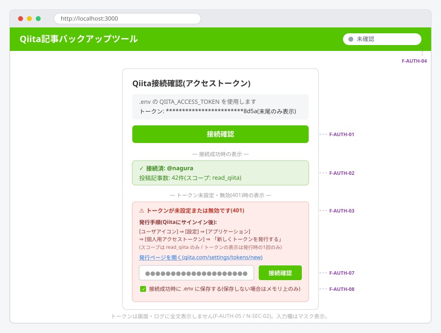
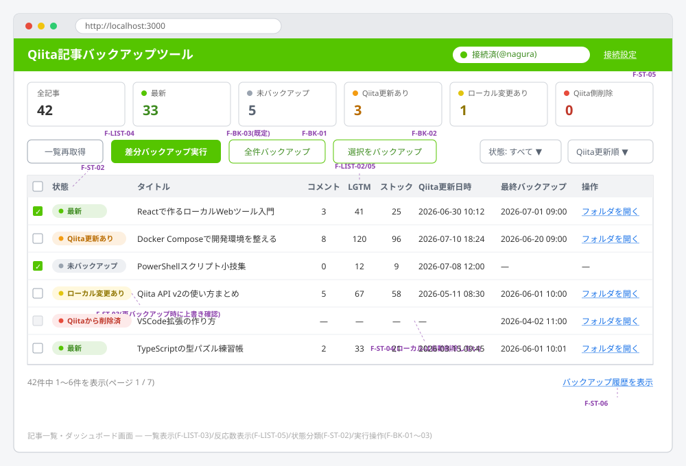
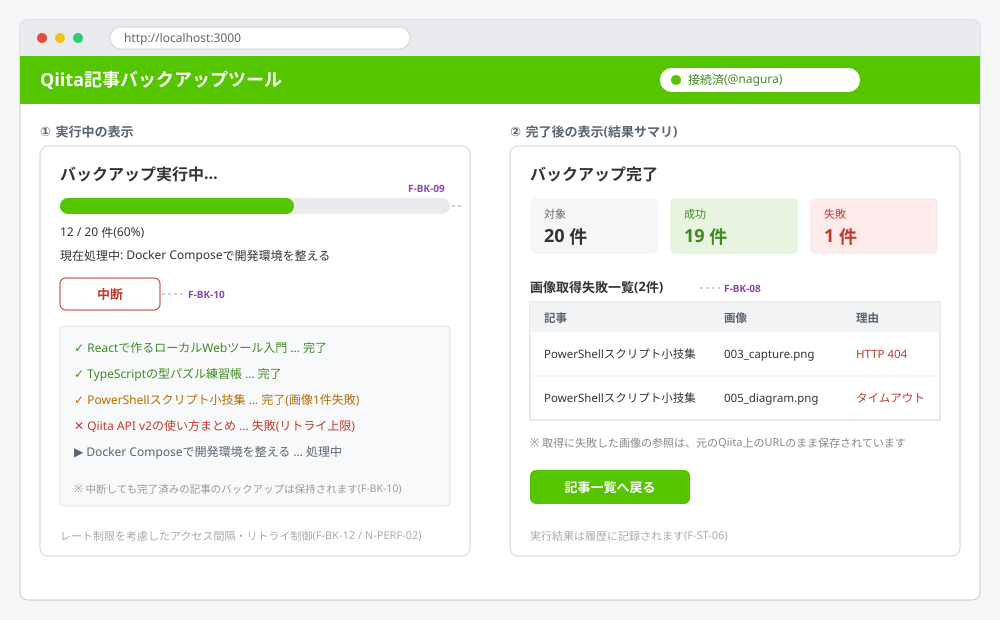
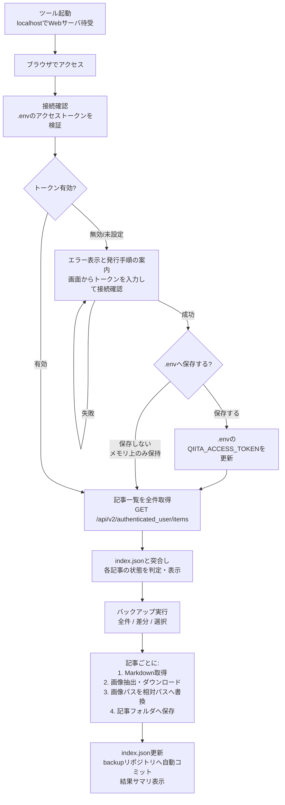

# Qiita記事バックアップツール 外部要件書

| 項目 | 内容 |
|---|---|
| 文書名 | Qiita記事バックアップツール 外部要件書 |
| 版数 | 1.9(`backup` ブランチをローカル専用としpushを拒否するF-GIT-09を追加) |
| 作成日 | 2026-07-12 |
| ステータス | ドラフト |

---

## 1. 概要

### 1.1 目的

Qiita上に投稿した個人の記事(本文Markdownおよび記事内で参照されている画像)を、ローカルPCのフォルダへバックアップするツールを開発する。
Qiitaのサービス障害・記事の誤削除・アカウントトラブル等に備え、記事資産をローカルで完全な形(Markdownビューワでそのまま閲覧可能な形)で保全することを目的とする。

### 1.2 システム形態

- ローカルPC上で動作する **Webアプリケーション**(以下「本ツール」)とする。
- ローカルでWebサーバプロセスを起動し、ユーザはPC上のWebブラウザから `http://localhost:{ポート}` にアクセスして操作する。
- 外部(インターネット側)へのサービス公開は行わない。ローカルからの利用のみとする。

### 1.3 同期の方向

- バックアップの方向は **Qiita → ローカルフォルダの単方向** とする。
- ローカルのファイルをQiitaへアップロード・反映する機能(逆方向同期・復元投稿)は本ツールの対象外とする。

---

## 2. 用語定義

| 用語 | 定義 |
|---|---|
| 記事 | アクセストークンに紐づくアカウントで投稿された記事(Item) |
| バックアップ | 記事のMarkdown本文と、本文から参照される画像ファイルをローカルへ保存すること |
| backupフォルダ | バックアップ先のルートフォルダ(既定: 本ツール配下の `backups/`) |
| 記事フォルダ | backupフォルダ直下に記事ごとに作成されるサブフォルダ |
| 管理情報 | 各記事のバックアップ状態・更新検知のためにツールが保持するメタデータ |
| アクセストークン | Qiitaの「個人用アクセストークン」。Qiita API v2呼び出しの認証に使用する(発行手順は [research/qiita-アクセストークン発行方法.md](../research/qiita-アクセストークン発行方法.md) 参照) |
| 世代管理 | 過去のバックアップ内容を、backupフォルダをローカルGitリポジトリとしてコミット履歴の形で保持すること(4.7参照) |

---

## 3. 前提条件・制約事項

1. ユーザは有効なQiitaアカウントを保有していること。
2. ユーザは事前にQiitaの設定画面から個人用アクセストークン(スコープ: `read_qiita` のみ)を発行しておくこと(発行手順は [research/qiita-アクセストークン発行方法.md](../research/qiita-アクセストークン発行方法.md) 参照)。トークンは本ツールのルートに配置する `.env` ファイルに登録するか、接続確認画面から入力する(F-AUTH-07)。
3. トークン発行時のQiitaへのサインイン(2FAを含む)は、ユーザ自身がWebブラウザ上で行う。本ツールはパスワード・2FAコードを一切扱わない。
4. 本ツールはインターネットに接続できる環境で使用すること。
5. バックアップ対象は「トークンを発行したアカウント本人の記事」のみとする。他ユーザの記事、Qiita Team(組織向け)の記事は対象外。
6. Qiita側のAPI仕様の変更により動作しなくなる可能性があることを許容する。
7. Qiita側の利用規約およびレート制限を遵守すること。
8. Qiita API v2の仕様上、記事一覧の取得上限は10,000件(`page` 最大100 × `per_page` 最大100)である。これを超える記事は対象外とする。
9. 世代管理(4.7)のため、実行環境でGitが利用可能であること(`git` コマンドがインストール済みであること。または同等のGitライブラリをツールに同梱してもよい)。

---

## 4. 機能要件

### 4.1 認証機能(アクセストークン方式)

Qiita API v2 の個人用アクセストークン(スコープ: `read_qiita`)を使用する。パスワード・2FAコードは本ツールでは扱わない(2FAはトークン発行時にユーザがブラウザ上でサインインする際にのみ使用される)。

| ID | 要件 |
|---|---|
| F-AUTH-01 | 本ツールは `.env` ファイルからアクセストークン(`QIITA_ACCESS_TOKEN`)を読み込み、Qiita API(`GET /api/v2/authenticated_user`)によりトークンの有効性を検証できること(接続確認)。 |
| F-AUTH-02 | 接続確認成功時、対象アカウントのユーザID(@xxx)と投稿記事数を画面に表示すること。以降のQiita APIアクセスはすべて `Authorization: Bearer {トークン}` ヘッダで行うこと。 |
| F-AUTH-03 | トークンが未設定・無効(HTTP 401)・権限不足(HTTP 403)の場合、原因が判別できるメッセージと、トークンの発行手順の案内、およびトークン入力欄(F-AUTH-07)を表示すること。発行手順の案内には、Qiitaサインイン後の画面遷移手順の簡潔な表示(`[ユーザアイコン] ⇒ [設定] ⇒ [アプリケーション] ⇒ [個人用アクセストークン] ⇒ 「新しくトークンを発行する」`、スコープは `read_qiita` のみ、トークンの表示は発行時の1回のみである旨)と、発行ページ `https://qiita.com/settings/tokens/new` への導線を含めること。 |
| F-AUTH-04 | 接続状態(未確認 / 接続済(@ユーザID) / トークン無効)を画面上で常時確認できること。 |
| F-AUTH-05 | トークンはメモリ上でのみ保持し(F-AUTH-08の保存時を除く)、画面・ログ・管理情報ファイルに全文を出力しないこと(表示が必要な場合は末尾4桁程度のマスク表示とする)。 |
| F-AUTH-06 | トークンの失効(無効化)はQiita側の設定画面で行う運用とし、本ツールは失効済みトークンを検知(401)した際に F-AUTH-03 の案内を表示すること。 |
| F-AUTH-07 | `.env` に `QIITA_ACCESS_TOKEN` が未設定の場合、または設定済みトークンが無効な場合、接続確認画面のトークン入力欄からユーザがトークンを入力して接続確認を実行できること。入力欄はマスク表示(パスワード型)とすること。 |
| F-AUTH-08 | 画面から入力したトークンで接続確認に成功した場合、ユーザの同意(チェックボックス等)に基づき `.env` ファイルの `QIITA_ACCESS_TOKEN` に保存できること。保存しない場合はメモリ上でのみ保持し、ツール終了時に破棄すること。`.env` への書き込みは既存の他の設定項目を破壊しないこと。 |

`.env` ファイルの想定項目:

```ini
# Qiita 個人用アクセストークン(スコープ: read_qiita)
# 未設定の場合は接続確認画面から入力できる(F-AUTH-07/08)
QIITA_ACCESS_TOKEN=your_personal_access_token

# 任意設定(既定値あり)
BACKUP_DIR=./backup
SERVER_PORT=3000
```

### 4.2 記事一覧取得機能

| ID | 要件 |
|---|---|
| F-LIST-01 | アクセストークンに紐づくアカウントに現在存在するすべての記事(限定共有記事を含む)の一覧をQiitaから取得できること(ページングされている場合も全件取得する)。 |
| F-LIST-02 | 記事一覧には少なくとも次の情報を含むこと: 記事ID、タイトル、Qiita上の作成日時、Qiita上の最終更新日時、記事URL、公開範囲(公開/限定共有)、コメント数、いいね(LGTM)数、ストック数。 |
| F-LIST-05 | コメント数・いいね(LGTM)数・ストック数を記事一覧画面(ダッシュボード)の各記事行に表示すること。外部からのリンク数(被リンク数)はQiita API v2で取得できないため表示対象外とする(8章 検討事項#6 参照)。 |
| F-LIST-03 | 記事一覧は画面上に表形式で表示し、各記事のバックアップ状態(4.5参照)を併せて表示すること。 |
| F-LIST-04 | 一覧の再取得(最新化)をユーザ操作で行えること。 |

### 4.3 バックアップ実行機能

| ID | 要件 |
|---|---|
| F-BK-01 | ユーザ操作により、全記事の一括バックアップを実行できること。 |
| F-BK-02 | ユーザ操作により、一覧から選択した記事のみの個別バックアップを実行できること。 |
| F-BK-03 | 「差分バックアップ」(未バックアップの記事、およびQiita側で更新のあった記事のみを対象とするバックアップ)を実行できること。既定の実行モードは差分バックアップとする。 |
| F-BK-04 | 記事本文は **Markdown形式(raw)** で取得し、記事フォルダに `.md` ファイルとして保存すること。 |
| F-BK-05 | Markdown本文中から参照されている画像(`` 形式、および `` 形式)をすべて抽出し、記事フォルダ配下の `images/` サブフォルダにダウンロード保存すること。 |
| F-BK-06 | 保存するMarkdown内の画像参照URLを、ダウンロードした画像ファイルへの **相対パス**(`images/ファイル名`)に書き換えること。これにより、保存されたMarkdownを一般的なMarkdownビューワ(VS Code、Typora等)で開いた際に画像が表示されること。 |
| F-BK-07 | 書き換え前のオリジナルMarkdown(画像URLがQiita上のURLのままのもの)も別ファイルとして保存すること(4.4参照)。 |
| F-BK-08 | 画像のダウンロードに失敗した場合、当該画像参照は元のURLのまま残し、失敗した旨を記事単位の結果および画面に表示すること(記事全体のバックアップ失敗とはしない)。 |
| F-BK-09 | バックアップ実行中は進捗(処理済み件数 / 対象件数、現在処理中の記事名)を画面に表示すること。 |
| F-BK-10 | バックアップ実行中の中断操作を提供すること。中断時、処理完了済みの記事のバックアップは有効なまま残すこと。 |
| F-BK-11 | 同一記事の再バックアップ時は、記事フォルダ内の既存ファイルを最新の内容で上書きすること(上書き前の内容はGitによる世代管理(4.7)でコミット履歴として保持される)。 |
| F-BK-12 | Qiitaへのアクセスはレート制限(認証あり1,000リクエスト/時)を考慮し、適切な間隔・リトライ制御を行うこと。レート制限超過(HTTP 429)時は、レスポンスヘッダが示すリセット時刻まで待機して処理を継続すること。 |

### 4.4 バックアップフォルダ・ファイル構成

| ID | 要件 |
|---|---|
| F-DIR-01 | バックアップ先ルートは `backups/` フォルダとする(`.env` で変更可能)。存在しない場合は自動作成すること。 |
| F-DIR-02 | 記事ごとに `backups/` 直下にサブフォルダ(記事フォルダ)を作成すること。フォルダ名は `{記事タイトル}_{記事ID}` とし、タイトル中のOSで使用できない文字(`\ / : * ? " < > |` 等)は `_` に置換すること。記事IDを含めることで一意性を保証する。 |
| F-DIR-03 | 記事フォルダの構成は次のとおりとすること。 |

```text
backups/
├── .git/                           # 世代管理用ローカルGitリポジトリ(4.7参照。ツール本体とは独立)
├── index.json                      # 管理情報(4.5参照)
├── {記事タイトル}_{記事ID}/
│   ├── {記事タイトル}.md           # 画像参照を相対パス化したMarkdown(閲覧用)
│   ├── original.md                 # 取得したままのMarkdown(画像URLはQiitaのまま)
│   ├── meta.json                   # 記事メタデータ(下記)
│   └── images/
│       ├── 001_{元ファイル名}.png
│       ├── 002_{元ファイル名}.png
│       └── ...
└── {記事タイトル}_{記事ID}/
    └── ...
```

| ID | 要件 |
|---|---|
| F-DIR-04 | 画像ファイル名は、記事内の登場順の連番 + 元URLから得られるファイル名を基本とし、記事フォルダ内で一意になること。元URLにファイル名相当が含まれない場合や過度に長い場合(`camo.qiitausercontent.com` 等のプロキシURL)は連番のみとし、拡張子はHTTPレスポンスのContent-Typeから決定すること。ファイル名はWindowsのパス長制限(260文字)を考慮して短く保つこと。 |
| F-DIR-05 | `meta.json` には少なくとも次を含むこと: 記事ID、タイトル、記事URL、公開範囲、タグ、Qiita上の作成日時・最終更新日時、コメント数・いいね(LGTM)数・ストック数(バックアップ時点の値)、バックアップ実行日時、画像ダウンロード結果(成功/失敗一覧)。 |
| F-DIR-06 | 記事タイトルの変更により記事フォルダ名が変わる場合、旧フォルダを新フォルダ名にリネームすること(記事IDで同一記事と判定する)。 |

### 4.5 バックアップ状態管理・更新検知機能

| ID | 要件 |
|---|---|
| F-ST-01 | 各記事のバックアップ状態を管理情報ファイル(`backups/index.json`)で永続管理すること。管理情報には記事ごとに、記事ID、最終バックアップ日時、バックアップ時点のQiita側更新日時、保存ファイルのハッシュ値(またはローカル保存時の更新日時)を含むこと。 |
| F-ST-02 | 記事一覧画面で、各記事を次のいずれかの状態に分類して表示すること。 |

| 状態 | 判定条件 | 表示例 |
|---|---|---|
| 未バックアップ | Qiitaに存在するが、ローカルにバックアップが存在しない | ⬜ 未 |
| バックアップ済(最新) | ローカルに存在し、Qiita側更新日時 = バックアップ時点の更新日時、かつローカルファイル無変更 | ✅ 最新 |
| Qiita側更新あり | Qiita側の最終更新日時が、バックアップ時点の更新日時より新しい | 🔄 Qiita更新あり(要再バックアップ) |
| ローカル変更あり | ローカルの `.md` ファイルがバックアップ後に変更・削除されている(ハッシュ不一致等) | ⚠ ローカル変更あり |
| Qiita側削除 | 過去にバックアップしたが、現在のQiita記事一覧に存在しない | 🗑 Qiitaから削除済 |

| ID | 要件 |
|---|---|
| F-ST-03 | 「ローカル変更あり」の記事を再バックアップする場合、ローカルの変更がQiita側の内容で上書きされる旨を確認したうえで実行すること(単方向同期のため、ローカル変更は保護対象としない)。 |
| F-ST-04 | 「Qiita側削除」の記事のローカルバックアップは自動削除しないこと(誤削除への備えという目的のため)。状態表示のみ行い、削除はユーザのファイル操作に委ねる。 |
| F-ST-05 | 状態の集計値(全記事数、未バックアップ数、要再バックアップ数など)を画面に表示すること。 |
| F-ST-06 | バックアップ実行履歴(実行日時、対象件数、成功/失敗件数)を確認できること。 |

### 4.6 画面要件

本ツールは最低限、次の画面(または1画面内の領域)を持つこと。

| 画面 | 内容 |
|---|---|
| 接続確認画面 | 接続確認ボタン(`.env` のアクセストークンを検証)、接続状態・アカウント情報表示、トークン未設定・無効時の発行手順案内とトークン入力欄(`.env` への保存可) |
| 記事一覧・ダッシュボード画面 | 記事一覧(タイトル、コメント数、いいね(LGTM)数、ストック数、Qiita更新日時、最終バックアップ日時、状態)、状態集計、一覧再取得ボタン、全件/差分/選択バックアップ実行ボタン |
| 実行状況表示 | バックアップ進捗(件数・処理中記事)、中断ボタン、完了後の結果サマリ(成功/失敗、画像取得失敗の一覧) |

#### 4.6.1 画面イメージ(設計レビュー用)

以下の画面イメージはレイアウト・配置要素を確認するためのワイヤーフレームであり、配色・文言・寸法は実装時に調整してよい。図中の紫色のラベル(例: `F-AUTH-02`)は、対応する要件IDを示すレビュー用注記である。

**(1) 接続確認画面**

`.env` のアクセストークンを読み込んで接続確認を実行し、アカウント情報を表示する(F-AUTH-01/02)。トークン未設定・無効時はエラーと発行手順の案内に加えてトークン入力欄を表示し、画面から入力したトークンで接続確認できる(F-AUTH-03/07)。接続成功時はユーザの同意に基づき `.env` へ保存できる(F-AUTH-08)。ヘッダ右上に常時接続状態を表示する(F-AUTH-04)。



**(2) 記事一覧・ダッシュボード画面**

上段に状態集計タイル(F-ST-05)、中段にバックアップ実行操作(F-BK-01〜03)と絞り込み・並び替え、下段に全記事の一覧と5分類の状態表示(F-LIST-03 / F-ST-02)を配置する。各記事行にはコメント数・いいね(LGTM)数・ストック数を表示し(F-LIST-05)、ローカルの記事フォルダを開ける。



**(3) 実行状況表示(実行中/完了後)**

実行中は進捗バー・処理中記事・記事単位の結果ログと中断ボタン(F-BK-09/10)を表示する。完了後は成功/失敗の集計と画像取得失敗の一覧(F-BK-08)を表示する。



#### 4.6.2 補足的な画面要件

- 記事一覧は状態・タイトルでの絞り込みまたはソートができること。
- 記事一覧から、ローカルの記事フォルダを開く導線(パス表示またはフォルダを開く操作)を提供すること。

### 4.7 世代管理機能(ローカルGit)

バックアップの世代管理はローカルGitで行う。`backups/` フォルダ自体を独立したGitリポジトリとし、バックアップ実行のたびに変更を自動コミットすることで、過去のバックアップ内容(上書き前のMarkdown・画像・管理情報)をコミット履歴として保持する。

| ID | 要件 |
|---|---|
| F-GIT-01 | 初回バックアップ実行時(または起動時)に `backups/` フォルダをGitリポジトリとして自動初期化(`git init`)すること。ツール本体のリポジトリとは独立した、`backups/` 配下のみを管理するリポジトリとすること。 |
| F-GIT-02 | リモートリポジトリへの push / pull は行わないこと(ローカル完結とし、限定共有記事等が誤って外部へ公開されることを防ぐ)。 |
| F-GIT-03 | バックアップ実行の完了時(中断時を含む)に、変更のあったファイル(記事フォルダ、`index.json`)をすべてステージして自動コミットすること。コミットメッセージには実行日時・対象件数・成功/失敗件数を含めること。 |
| F-GIT-04 | 変更が1件もない場合は空のコミットを作成しないこと。 |
| F-GIT-05 | 記事タイトル変更による記事フォルダのリネーム(F-DIR-06)もコミットに含め、同一記事として履歴を追跡できること。 |
| F-GIT-06 | 過去世代の閲覧・復元は標準のGit操作(`git log` / `git diff` / `git checkout` 等)やGitクライアントで行う運用とし、本ツールは復元UIを提供しない(7章参照)。バックアップ履歴画面(F-ST-06)に直近のコミット履歴(日時・メッセージ・コミットID)を表示してもよい。 |
| F-GIT-07 | Gitが利用できない環境では、その旨を警告表示したうえで、世代管理なし(最新1世代のみ)でバックアップを実行できること。 |
| F-GIT-08 | バックアップのコミットは常に `backup` ブランチで行うこと。リポジトリ初期化時は初期ブランチを `backup` とし、既存リポジトリが別ブランチの場合は `backup` ブランチへ切り替えて(未存在時は現在の履歴を引き継いで作成して)からコミットすること。 |
| F-GIT-09 | `backup` ブランチはローカル運用専用とすること。バックアップリポジトリに pre-push フックを自動設置し、`backup` ブランチのリモート送信(push)を手動操作を含めて拒否すること(限定共有記事の誤公開防止)。ユーザが独自の pre-push フックを設置済みの場合は上書きしない。 |

---

## 5. 非機能要件

### 5.1 セキュリティ

| ID | 要件 |
|---|---|
| N-SEC-01 | `.env` ファイルの内容(アクセストークン)を、Qiita(`qiita.com`)以外の外部サーバへ送信しないこと。 |
| N-SEC-02 | アクセストークンを画面表示およびログに平文出力しないこと(表示が必要な場合は末尾4桁程度のマスク表示とする)。 |
| N-SEC-03 | Webサーバは `localhost`(ループバックアドレス)のみで待ち受けること。 |
| N-SEC-04 | プロジェクトをGit管理する場合に備え、`.env` および `backups/` を `.gitignore` に含める構成を既定とすること。`.env` のテンプレートとして `.env.example` を同梱すること。なお `backups/` は世代管理のため独立したGitリポジトリとなるが(4.7)、ツール本体リポジトリの `.gitignore` に `backups/` を含める構成と両立する。 |
| N-SEC-05 | 画像ファイル等のダウンロードで `qiita.com` 以外のホスト(`camo.qiitausercontent.com`、`qiita-image-store.s3.*` 等)へアクセスする際、`Authorization` ヘッダ等の認証情報を送信しないこと(これらの画像取得に認証は不要)。 |

### 5.2 性能・信頼性

| ID | 要件 |
|---|---|
| N-PERF-01 | 記事数300件・記事あたり画像10枚程度の規模で実用的な時間内(目安: 30分以内)に全件バックアップが完了すること。 |
| N-PERF-02 | 通信エラー・一時的なQiita側エラーに対し、記事単位でリトライ(回数上限あり)を行うこと。リトライ上限超過時は当該記事を失敗として記録し、処理を継続すること。 |
| N-PERF-03 | バックアップ処理が途中で異常終了しても、管理情報(`index.json`)が破損しないこと(書き込みはアトミックに行うこと)。 |

### 5.3 運用・保守

| ID | 要件 |
|---|---|
| N-OPS-01 | 実行ログをファイル出力し、エラー発生時の原因調査ができること。 |
| N-OPS-02 | Windows環境(Windows 11)で動作すること。 |
| N-OPS-03 | ツールの起動はコマンド1つ(またはスクリプト1つ)で行え、起動後にブラウザでアクセスするURLが表示されること。 |

---

## 6. 処理フロー(概要)



---

## 7. 対象外事項(スコープ外)

以下は本ツールの対象外とする。

1. ローカル → Qiita方向の同期(記事の投稿・更新・復元)。
2. 他ユーザの記事、Qiita Teamの記事のバックアップ。
3. コメント本文、いいね・ストックしたユーザの一覧等、記事本文・画像以外の詳細情報の保全(コメント数・いいね(LGTM)数・ストック数の件数は `meta.json` に記録し、一覧画面に表示する)。
4. バックアップリポジトリのリモート同期(push / pull / リモート登録)、および過去世代の閲覧・復元用UI(世代管理はローカルGitのコミット履歴として保持し(4.7)、閲覧・復元は標準のGit操作・Gitクライアントに委ねる)。
5. ローカルバックアップの自動削除。
6. 定期実行スケジューラ(バックアップはユーザの手動操作で実行する)。

---

## 8. 検討事項(内部設計時に決定する事項)

| # | 事項 | 備考 |
|---|---|---|
| 1 | Qiitaからの記事取得手段(**決定済**) | 調査([research/qiita-api接続方法調査.md](../research/qiita-api接続方法調査.md))の結果、**Qiita API v2 + 個人用アクセストークン方式に決定**(v1.2で反映)。記事一覧・本文(raw Markdown)は `GET /api/v2/authenticated_user/items` で取得する。 |
| 2 | 限定共有記事の扱い | 既定ではバックアップ対象に含める。除外オプションの要否は内部設計で決定する。 |
| 3 | 下書き記事の扱い | 「現在存在する記事」に下書きを含めるか。初版では公開済(公開・限定共有)のみを対象とする。 |
| 4 | 画像以外の添付(GIF・PDF等) | Markdownから参照されるリンク先のうち、画像(image/*)のみを対象とする。 |
| 5 | 実装技術 | 言語・フレームワーク(例: Node.js + Express、Python + FastAPI 等)は内部設計で決定する。 |
| 6 | 外部からのリンク数(**対象外に決定**) | 記事への被リンク数はQiita API v2に該当フィールドがなく取得できない(閲覧数 `page_views_count` も通常nullが返る)。取得には外部の検索エンジンAPI等が必要となるため、本ツールでは表示対象外とする。将来Qiita側で提供された場合に再検討する。 |
| 7 | バックアップリポジトリの肥大化対策 | 画像バイナリの更新が繰り返されるとGit履歴が肥大化する。初版では対策なし(ローカルディスク容量に依存)とし、必要に応じて `git gc` の自動実行や履歴の間引きを将来検討する。 |
