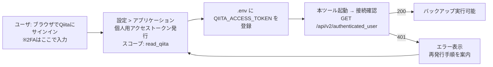

# Qiita 個人用アクセストークン 発行方法 調査報告

| 項目 | 内容 |
|---|---|
| 調査日 | 2026-07-12 |
| 調査目的 | 認証方式を個人用アクセストークン方式に変更する([qiita-api接続方法調査.md](qiita-api接続方法調査.md) 9章の決定)ことに伴う、トークンの発行・管理手順の整理 |
| 位置づけ | 本ツールのユーザ向けセットアップ手順(README等)の原稿となる資料 |

---

## 1. 発行手順(ユーザが1回だけ行う作業)

1. Webブラウザで [https://qiita.com/](https://qiita.com/) にサインインする
   - **2FA(二要素認証)を有効にしているアカウントは、ここでコードを入力する**(2FAが関与するのはこの発行時のみ。ツールの実行時には不要)
2. 画面右上のユーザアイコン →「**設定**」→ 左メニュー「**アプリケーション**」を開く
   - 直接URL: [https://qiita.com/settings/applications](https://qiita.com/settings/applications)
3. ページ内「**個人用アクセストークン**」欄の「**新しくトークンを発行する**」をクリック
   - 直接URL: [https://qiita.com/settings/tokens/new](https://qiita.com/settings/tokens/new)
4. 発行フォームに入力する
   - **アクセストークンの説明(Description)**: 用途がわかる名前(例: `qiita-backup-tool`)
   - **スコープ**: **`read_qiita` のみ** にチェックする(下表参照。バックアップは読み取り専用のため書き込み権限は付けない)
5. 「**発行する**」をクリック
6. 画面に表示されたトークンを **その場でコピー** する
   - ⚠ **トークン全文が表示されるのはこの1回だけ。** 再表示はできず、忘れた場合は削除して再発行するしかない
7. 本ツールの `.env` に登録する

```ini
# .env
QIITA_ACCESS_TOKEN=ea5d0a593b2655e9568f144fb1826342292f5c6b7d406fda00577b8d1530d8a5
```

### スコープの選択

| スコープ | 権限 | 本ツール |
|---|---|---|
| `read_qiita` | Qiitaからユーザに関連したデータを読み出す(限定共有記事含む) | ✅ 必須 |
| `write_qiita` | Qiitaにデータを書き込む | ❌ 不要(単方向バックアップのため) |
| `read_qiita_team` / `write_qiita_team` | Qiita Team用 | ❌ 対象外 |

---

## 2. トークンの仕様

| 項目 | 内容 |
|---|---|
| 形式 | 64桁の16進文字列(公式APIドキュメントの例より) |
| 使い方 | リクエストヘッダ `Authorization: Bearer {トークン}` |
| 有効期限 | **発行フォームに有効期限の設定項目はなく、削除(失効)するまで有効** とされている(公式に期限を明記した資料は見つからなかったため、実装ではトークン無効の検知(401)を必須とする) |
| 発行数 | 複数発行可能(用途ごとに分けて発行し、個別に失効できる) |
| レート制限 | トークン(ユーザ)単位で 1,000リクエスト/時 |

---

## 3. 動作確認方法

発行したトークンが有効かどうかは、認証中ユーザ取得APIで確認できる。

```bash
curl -s -w "\nHTTP %{http_code}\n" \
  -H "Authorization: Bearer $QIITA_ACCESS_TOKEN" \
  https://qiita.com/api/v2/authenticated_user
```

| 結果 | 意味 |
|---|---|
| `200` + ユーザ情報JSON | トークン有効。`id`(ユーザID)と `items_count`(投稿記事数)が取れる |
| `401 {"message":"Unauthorized","type":"unauthorized"}` | トークンが無効(失効済み・誤記) |
| `403` | 権限不足(スコープ不足など) |
| `429` | レート制限超過(リセット時刻まで待機) |

本ツールの「接続確認」機能(F-AUTH-01)はこのエンドポイントをそのまま使えばよい。

---

## 4. 失効(無効化)・再発行の方法

**トークンが漏洩した疑いがある場合や不要になった場合は、即座に失効させる。**

| 方法 | 手順 |
|---|---|
| 設定画面から削除(通常はこちら) | [https://qiita.com/settings/applications](https://qiita.com/settings/applications) の「個人用アクセストークン」一覧から該当トークンを削除 |
| APIから失効 | `DELETE https://qiita.com/api/v2/access_tokens/:access_token` → `204 No Content` |

再発行は1章の手順を繰り返し、`.env` の値を差し替えるだけでよい(ツール側の再設定は不要)。

---

## 5. セキュリティ上の取り扱い注意

1. **`.env` をGit管理に含めない**(`.gitignore` に登録。配布用には値を空にした `.env.example` を用意)
2. **スコープは `read_qiita` のみ**とし、万一漏洩しても書き込み被害が起きないようにする
3. トークンを**画面・ログ・管理ファイル(index.json等)に全文出力しない**(表示が必要な場合は末尾4桁程度のマスク表示)
4. **`qiita.com` 以外のホストへ `Authorization` ヘッダを送らない**(画像ダウンロード先の `camo.qiitausercontent.com` / `qiita-image-store.s3.*` は認証不要であり、送るとトークン漏洩リスクになる)
5. 漏洩を疑ったら4章の手順で**即失効→再発行**

---

## 6. 本ツールにおける利用フロー



- ユーザの初期作業は1〜2分で完了する
- 2FAはトークン発行時のブラウザ操作の中で完結するため、**本ツールはパスワード・2FAコードを一切扱わない**
- 「2FAはユーザ入力とする」という当初要望は、この発行フローで自然に満たされる

---

## 7. 参考資料

- [Qiita API v2 ドキュメント(公式)— 認証・アクセストークン](https://qiita.com/api/v2/docs)
- [Qiita 設定 > アプリケーション(トークン管理画面)](https://qiita.com/settings/applications)
- [Qiita 新規トークン発行ページ](https://qiita.com/settings/tokens/new)
- [Qiita APIを触ってみる(発行手順の実例)](https://qiita.com/miyuki_samitani/items/bfe89abb039a07e652e6)
- [Qiita APIのレート制限を気にせず大量取得する方法【トークン設定Tips】](https://qiita.com/kotajobs0/items/1d8c4ae8c86516e25b2b)
- [Qiita API v2 を使って自身の全投稿をエクスポートする Python スクリプト](https://qiita.com/sta/items/5074df5fcb81d890897b)
